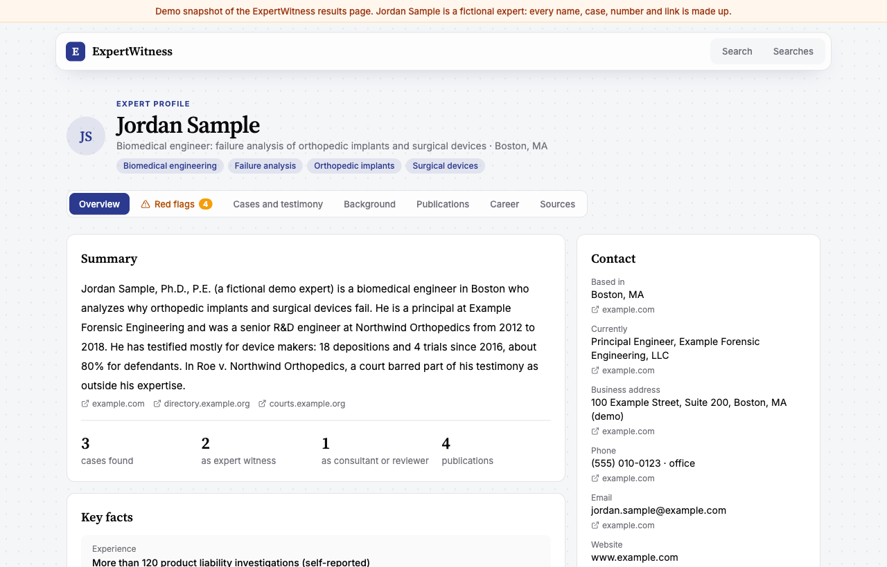
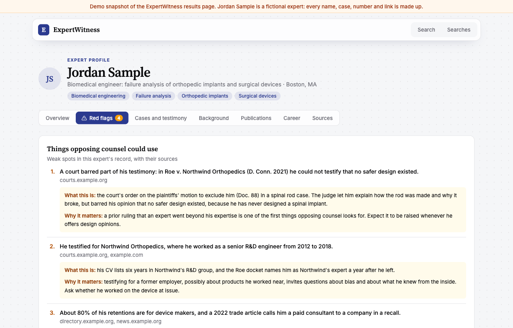
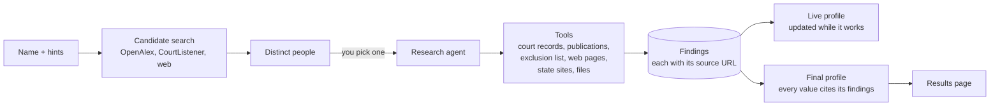
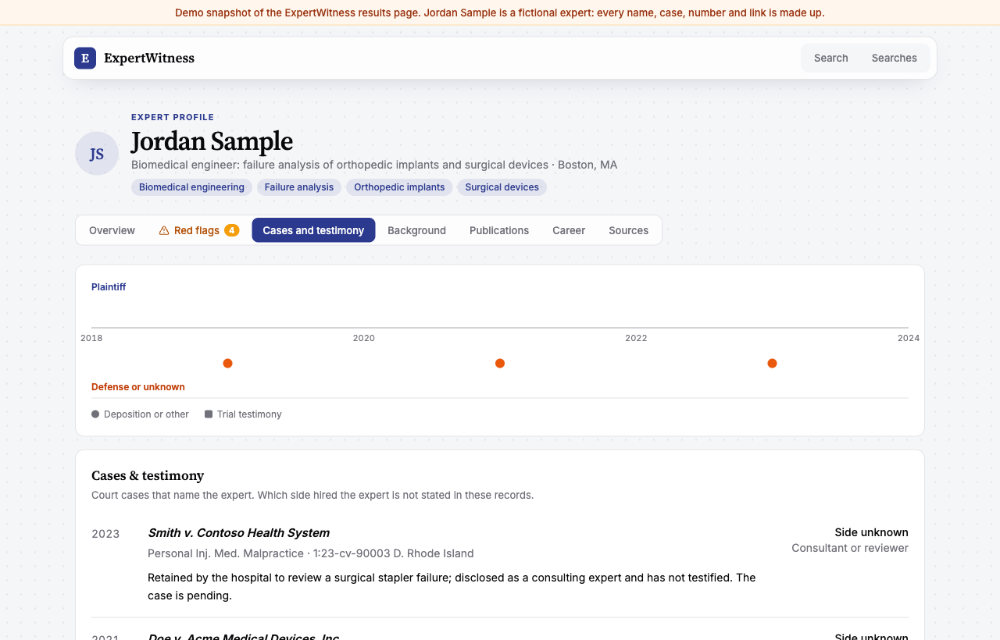

# ExpertWitness

[](https://github.com/newcase-ai/ExpertWitness/actions/workflows/ci.yml)

**Name in, cited expert profile out.** Search for an expert witness and pick the right person. An AI
research agent then works through public records (court filings, publications, exclusion lists,
licensing sites and the web) and builds a profile where every fact links to its source.

It is built for litigation teams vetting an opposing expert, or their own expert before retention.



> **See a result without running anything.** Download
> [`docs/demo/expert-profile-demo.html`](docs/demo/expert-profile-demo.html) and open it in a browser.
> It is a one-file snapshot of the results page for a fictional expert, and the tabs and pop-ups work offline.

## What it does

1. **Find the right person.** You type a name, plus an optional field, location or employer. A short
   candidate search checks OpenAlex, CourtListener and the web, then groups the hits into distinct people,
   so two experts with the same name stay apart.
2. **Research them.** You pick a candidate and a research job starts in the background. The research agent
   decides what to look at next, using tools for its sources and tasks. Every finding is saved with its
   source URL and when it was retrieved. The page shows each step live.
3. **Read the profile.** When the run ends, the findings are organized into one profile:

| Tab | What's in it |
| --- | --- |
| Overview | Summary, contact, key facts and recent cases |
| Red flags | Things opposing counsel could use, with their sources (shown only when there are some) |
| Cases and testimony | Federal cases that name the expert, and their role in each |
| Background | License status, board discipline, the federal exclusion list and retracted papers |
| Publications | Papers, citation counts and online presence |
| Career | Roles, education, licenses, and people with the same name who were ruled out |
| Sources | Every page and filing the profile cites |



## How it works



- **One research agent, many tools.** The agent runs on Google ADK with Meta's Model API (through LiteLLM)
  and chooses each next step. Each source has its own tools, which enforce that source's rules in code:
  rate limits, banned sites, and what may be stored.
- **A court-records helper.** Court research goes to a helper agent. It searches CourtListener, sorts out
  people with the same name, downloads the filings that may be the expert's (with OCR for scans) and records
  a verdict for each case. When a key filing is not public, it can ask to buy it from PACER (`pay_for_document`).
  A separate payment service (`app/purchases.py`) decides from CourtListener's record of the filing, never from
  the agent: at most $3 a filing, $10 a run, and a value check. By default this is a dry run: an approved request is
  only recorded as "would buy" and nothing is charged. With `PAYMENTS_LIVE=true`, an approved request gets a
  one-time [Ramp](https://docs.ramp.com/developer-api/v1/virtual-cards) virtual card for its price, which is closed
  when the run ends.
- **Two profiles.** A live profile updates as findings come in. At the end, one model call organizes
  everything into the profile the results page shows. A value that cites no collected finding is dropped, and
  contact details must appear in a cited source.



### Sources

| Source | Used for |
| --- | --- |
| [CourtListener](https://www.courtlistener.com/) (RECAP archive of PACER, and opinions) | Federal cases, filings and rulings on testimony |
| [OpenAlex](https://openalex.org/) | Publications and citation counts |
| [Crossref](https://www.crossref.org/) | Retraction checks |
| [OIG LEIE](https://oig.hhs.gov/exclusions/) | The federal health-care exclusion list |
| Meta web search, through the model API | Candidates and facts from the web |
| [Firecrawl](https://www.firecrawl.dev/) | Reading web pages and PDFs, and site searches |
| State court and licensing sites | State cases, licenses and discipline; it finds each state's official sites and how to search them, never behind a login |

## Guardrails

These rules are enforced in code, not just in the prompt:

- **Professional records only.** The output is not a background check or a consumer report (FCRA).
- **Cited or dropped.** The AI only summarizes sources the run collected, and a claim without a matching source
  is removed.
- **Sites it never automates:** LinkedIn, Google Scholar, Daubert Tracker, TrialSmith, CPAverify, BrokerCheck,
  ABMS and DocInfo. It never logs in to scrape, bypasses a CAPTCHA or rotates IPs.
- **No third-party text in the results.** Findings and the profiles hold only URLs, titles and our own extracted
  facts, never search snippets or page text. Downloaded files (CVs, court filings) stay on the server's disk in
  `backend/data/files/` so the agent can read them. The run trace, for debugging, keeps the agent's turns and
  tool arguments, with tool replies cut to 300 characters (`DEBUG_TRACE=1` keeps everything, for local
  debugging only).
- **Source limits respected.** For example, CourtListener allows 5 calls a minute, 50 an hour and 125 a day.
- **Same-name safety.** A surname alone never counts as a match, and a case is only attached to the expert after
  a same-person verdict.

The full list of rules, the numbered "gotchas", is in [CLAUDE.md](CLAUDE.md#gotchas).

## Run it locally

**Requirements:** Python 3.12+, [uv](https://docs.astral.sh/uv/) and Node.js 20+.

```sh
# 1. Backend: the API on http://localhost:8000, with interactive docs at /docs
cd backend
cp .env.example .env    # then fill in the keys below
uv sync
uv run fastapi dev app/main.py

# 2. Frontend, in a second terminal: http://localhost:5173 (proxies /api to the backend)
cd frontend
npm install
npm run dev
```

Open http://localhost:5173, search for a name, pick the right person and start the research. Past searches
and runs are under **Searches**.

Settings in `backend/.env`:

| Variable | Needed for |
| --- | --- |
| `MODEL_API_KEY` | **Required.** A Meta Model API key; searches and research return 503 without it |
| `MODEL_NAME` | Optional, default `muse-spark-1.3`. Never a `-contributor` model (Meta's terms, §6.2) |
| `COURTLISTENER_TOKEN` | Court records ([CourtListener API](https://www.courtlistener.com/help/api/rest/)); without it, court research shows as a gap |
| `COURTLISTENER_TOKEN_FALLBACK` | Optional. A second token, used when the first is refused (HTTP 401/403) or not set |
| `CONTACT_EMAIL` | Sent with requests so OpenAlex and Crossref can reach you (their "polite pool") |
| `FIRECRAWL_API_KEY` | Reading web pages and PDFs, site guides and Firecrawl searches; those tools are skipped without it |
| `DATABASE_PATH` | Optional, default `backend/data/expert_witness.db` |
| `DEBUG_TRACE` | Optional. `1` keeps the full run trace, for local debugging only |
| `PAYMENTS_LIVE` | Optional, default `false`. `true` makes a one-time Ramp card for each approved filing purchase |
| `RAMP_CLIENT_ID`, `RAMP_CLIENT_SECRET`, `RAMP_USER_ID`, `RAMP_ENV` | Ramp cards (needed with `PAYMENTS_LIVE=true`). `RAMP_ENV` is `sandbox` (default) or `production` |

The frontend also has two design mockups with canned data, `/experts/demo-1` and `/experts/demo-2`. Their data
is in `frontend/src/lib/mocks/`.

## Tests and checks

```sh
cd backend
uv run pytest -q      # fully offline: fake sources, fake AI, fictional people
uv run ruff check

cd ../frontend
npm run build         # type check and production build
```

Run all three before you push.

## Repo layout

```
backend/
  app/main.py              API routes
  app/jobs.py              background jobs: candidate search and research
  app/research_agent.py    the research agent
  app/tools/               agent tools, one file per source or task
  app/sources/             source clients: HTTP, rate limits, caching
  app/profile.py           the live profile, updated while the agent works
  app/expert_profile.py    the final, structured profile
  app/purchases.py         the payment service for court filings (dry run by default)
  tests/                   offline tests with fakes
  DESIGN.md                the design and the tool cards
frontend/src/
  pages/                   one routed page per file
  components/              the pieces of the profile and the live run
  lib/api.ts               the only place that calls the backend
docs/
  demo/                    a one-file demo of the results page (fictional expert)
  images/                  the screenshots in this README
  expert-profile-spec.md   the structured profile spec
```

## More docs

- [CLAUDE.md](CLAUDE.md): conventions, the full layout and the numbered gotchas, for agents and teammates
- [backend/README.md](backend/README.md): backend setup and the API endpoints
- [backend/DESIGN.md](backend/DESIGN.md): the architecture, tool cards, sources and decisions
- [docs/expert-profile-spec.md](docs/expert-profile-spec.md): what the structured profile holds

## Data and privacy

Everything a run collects (the SQLite database and downloaded files) stays in `backend/data/`, which git ignores.
The repo is public, so never commit `.env`, keys, real people's data or court documents. The tests, the
screenshots and the demo use fictional people only.
