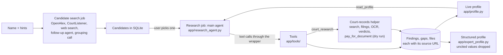

# Expert Witness Research API: Design

Status: built (first draft 2026-10-28). Section 1 is the current flow, 4B the research agent with one
card per tool (4B.9), and 9 the module map. Sections 2-4A are the first design (M1-M6): 4.1 and 4A
still describe the candidate search; parts later replaced are marked.
The numbered gotchas are in the root `CLAUDE.md`.
Every outside fact has a link. "Not verified" means we could not confirm it on an official page.
JSON examples use a made-up person ("Alex Rivera") and placeholder ids; they are not sources.

## 1. Flow overview

The flow as built (checked against the code on 2026-11-04).

1. The user types a name (plus optional hints: field, location, employer).
2. **Candidate search** (a short job, 4.1 and 4A): code searches OpenAlex, CourtListener opinions and
   Meta's built-in web search in parallel, a small follow-up agent may search again, then one AI call
   groups the hits into distinct people. Code checks every merge and ranks them. Each person is saved
   in SQLite with a stable `candidate_id`.
3. The user picks one candidate (`POST /research`, optionally with a pasted case list that is never
   stored, except in a `DEBUG_TRACE=1` trace).
4. **Research job** (4B): one ADK agent, the main agent (`app/research_agent.py`), picks each next step
   from its tools (4B.9) until it replies DONE or hits the time or step limit (`RESEARCH_SECONDS`,
   `MAX_AGENT_CALLS`); each tool also has a cap per run. Every call goes through one wrapper
   (`app/tools/__init__.py`: caps, clock, banned sites, activity row, trace). Tools save findings with
   their source URL and retrieval time, gaps and downloaded files. `court_research` hands court records
   to a helper agent: it searches CourtListener's RECAP archive, sorts out people with the same name,
   reads filings (OCR for scans), records a verdict per case, and may ask `pay_for_document` for a
   filing that is not public (a dry run decided by `app/purchases.py`: nothing is bought).
5. **Live profile** (`app/profile.py`): after each tool call that saved findings, one AI call merges them
   into the run's profile; items that cite no finding are dropped. The agent reads it with `read_profile`.
6. **Structured profile** (`app/expert_profile.py`): when the agent stops, one AI call organizes the
   findings and the text of CV and practice-site files into the results page's fields. Code drops any
   value that cites nothing the run collected, and contact details not written in a cited source; cases,
   filings, publications and the exclusion and retraction checks are built by code from findings.
7. The frontend polls `GET /jobs/{id}`, `GET /jobs/{id}/events` and the live profile while the job runs,
   then reads `GET /dossiers/{id}/expert-profile`.



## 2. API contract (1a)

All bodies are JSON. Ids are opaque strings with a prefix (`srch_`, `cand_`, `job_`, `dos_`),
created once and stored in SQLite, so they never change. Errors use FastAPI's default shape
`{"detail": "message"}`; request-validation errors (422) use FastAPI's default list form.

**Decision: candidate search is a job, not a plain request.** With web search it may take
20-30 s (our estimate, not measured), which is long for one HTTP request and gives the frontend
nothing to show. As a job, the frontend uses the same polling and progress UI for both steps,
and the finished result is stored so `candidate_id`s are stable.

| Method | Path | Purpose |
| --- | --- | --- |
| GET | `/health` | Liveness check (exists today) |
| POST | `/candidate-searches` | Start a candidate search job |
| GET | `/candidate-searches/{search_id}` | Read the candidate list |
| POST | `/research` | Start a research job for one candidate |
| GET | `/jobs/{job_id}` | Job status and per-step progress (both job kinds) |
| GET | `/dossiers/{dossier_id}` | Read the finished dossier |

Routes added since M1 (full list: `backend/README.md`): `GET /candidate-searches`,
`GET /jobs/{job_id}/events` (4B.6b), `GET /dossiers/{dossier_id}/findings` (M3), `/profile`,
`/expert-profile`, `POST /dossiers/{dossier_id}/expert-profile/rebuild`, `/photo` and `/files`.

### GET /health
200 `{"status": "ok"}`. No errors.

### POST /candidate-searches
Request:
```json
{"name": "Alex Rivera", "hints": {"field": "toxicology", "location": "Ohio", "affiliation": null}}
```
- `name`: required, 2-120 characters after trimming, must contain a letter.
- `hints`: optional; every field optional. Hints go into the prompt and the ranking only.

Response 202:
```json
{"search_id": "srch_01", "job_id": "job_01", "status": "queued"}
```
Errors: 422 bad input (empty, too long, no letters, unknown fields);
503 `{"detail": "MODEL_API_KEY is not set"}` (the AI is needed to group people).
A missing CourtListener token is **not** an error: that source shows as failed in the result.

### GET /candidate-searches/{search_id}
Response 200 (while the job runs, `status` is `queued` or `running` and `candidates` is empty):
```json
{
  "search_id": "srch_01", "name": "Alex Rivera", "status": "done",
  "created_at": "2026-10-28T15:00:00Z",
  "candidates": [ { "candidate_id": "cand_01", "...": "see section 3" } ],
  "failed_sources": [{"source": "courtlistener", "reason": "COURTLISTENER_TOKEN is not set"}],
  "error": null,
  "notice": null
}
```
- People with expert-witness evidence come first; same-name people without it follow, flagged
  `"expert_evidence": false` (section 4.1). A `done` search with zero candidates at all has
  `"notice": "No expert-witness evidence found for this name."`, unless every source
  (`openalex`, `courtlistener`, `web_search`) failed: then `failed_sources` explains it. Otherwise `null`.

Errors: 404 unknown `search_id`. If the job failed: 200 with `status: "failed"`, empty
`candidates` and `error` set, e.g. `"error": "AI grouping step failed after 1 retry"`.

### POST /research
Request: `{"candidate_id": "cand_01"}`

Response 202: `{"job_id": "job_02", "dossier_id": "dos_01", "status": "queued"}`
- Double submit: if a research job for the same candidate is already `queued` or `running`,
  return **200** with that job's ids instead of starting a second one.
- A new POST after a finished job starts a fresh run with a new `dossier_id`.

Errors: 404 unknown `candidate_id`; 422 bad body; 503 `MODEL_API_KEY` not set.

### GET /jobs/{job_id}
Response 200:
```json
{
  "job_id": "job_02", "kind": "research", "status": "running",
  "created_at": "2026-10-28T15:01:00Z", "started_at": "2026-10-28T15:01:01Z", "finished_at": null,
  "progress": {"done": 2, "total": 6},
  "steps": [
    {"key": "courtlistener", "label": "Court opinions", "status": "running", "detail": "3 of 8 calls", "finished_at": null},
    {"key": "openalex", "label": "Publications", "status": "done", "detail": "92 works", "finished_at": "2026-10-28T15:01:09Z"},
    {"key": "crossref", "label": "Retraction check", "status": "done", "detail": "0 retractions", "finished_at": "2026-10-28T15:01:12Z"},
    {"key": "oig_leie", "label": "OIG exclusions", "status": "pending", "detail": null, "finished_at": null},
    {"key": "web_credentials", "label": "Licence and board pages", "status": "pending", "detail": null, "finished_at": null},
    {"key": "write_dossier", "label": "Writing dossier", "status": "pending", "detail": null, "finished_at": null}
  ],
  "result": null,
  "error": null
}
```
- Job `status`: `queued` -> `running` -> `done` | `failed`. Step `status`: `pending`, `running`,
  `done`, `failed`, `skipped` (e.g. no token, budget used up).
- Candidate-search steps: `openalex`, `courtlistener`, `web_search`, `group_candidates`.
- When done, `result` is `{"kind": "dossier", "id": "dos_01"}` or `{"kind": "candidate_search", "id": "srch_01"}`.
- A failed step does **not** fail the job; it becomes a gap. The job fails only if the final AI
  step fails (`error` explains why).
- Jobs that were `queued` or `running` when the server stopped are marked `failed` with
  `error: "interrupted by restart"` at startup.

Errors: 404 unknown `job_id`.

Part 2 change (M7): every job also returns an `activity` list, and the research job has one
step row (`main_agent`). See 4B.6.

### GET /dossiers/{dossier_id}
200: the research run, `{"dossier_id", "candidate_id", "job_id", "status", "display_name"}`, so a page can
follow a run after a reload. 404 `{"detail": "dossier not found"}`. No 409: the dossier of section 3 was
never built; the results page reads `GET /dossiers/{dossier_id}/expert-profile` (409 while the job runs).

### GET /dossiers/{dossier_id}/findings
Added in M3. The raw findings the collectors saved, before any AI writing:
`{"dossier_id", "candidate_id", "job_id", "status", "findings": [Finding], "gaps": [{"step", "reason"}]}`.
A Finding is `{finding_id, collector, kind, title, url, source_type, retrieved_at, confidence, facts, note}`;
web findings are always `confidence: "low"` with a "verify" note. 404 unknown id; 409 while the
job is not done: `{"detail": "findings not ready: job job_02 is running"}`.

## 3. Data shapes

### Candidate
```json
{
  "candidate_id": "cand_01",
  "display_name": "Alex J. Rivera",
  "summary": "Toxicologist who has published on solvent exposure and appears as an expert in product cases.",
  "field": "toxicology",
  "affiliations": ["Example State University"],
  "location": "Ohio, US",
  "identifiers": {"openalex": ["A0000000001", "A0000000002"], "orcid": "0000-0000-0000-0000"},
  "evidence": [
    {"source": "openalex", "url": "https://api.openalex.org/authors/A0000000001", "title": "OpenAlex author record", "note": "92 works, last institution Example State University"},
    {"source": "courtlistener", "url": "https://www.courtlistener.com/opinion/0/example/", "title": "Doe v. Example Co.", "note": "full name appears near 'expert'"},
    {"source": "web", "url": "https://example.edu/faculty/rivera", "title": "Faculty page", "note": "lists toxicology appointment"}
  ],
  "match_notes": "Two OpenAlex ids merged: same ORCID. Court hit uses full name.",
  "expert_signals": ["court_opinion_expert", "web_expert_witness"],
  "expert_evidence": true,
  "expert_note": null
}
```
- `evidence` is never empty; every item has a source URL (M2 check 2c).
- `identifiers.openalex` is a list because one person is often split over several ids (gotcha 12).
- `expert_signals` is set by code from the evidence, strongest first: `court_opinion_expert`
  (a CourtListener hit from the expert-role query), `expert_directory` (a web result on a known
  expert-directory domain), `web_expert_witness` (a web result whose title or URL contains the whole
  word "expert" or "experts", e.g. "expert witness", "expert-witness", "expert_witness"; not
  "expertise", "inexpert", "expertly", or whose domain contains "expertwitness"/"expert-witness",
  e.g. riveraexpertwitness.example). Signals come from source data only: AI-written text never earns
  one, and being returned by the expert query alone is not enough.
- `location` is AI-written text. Code compares only the US state at its end (a full state name or
  a 2-letter code, e.g. "Gilbert, Arizona", "Concord, MA"; "Washington, DC" is DC, its own place).
  Cities are never compared, and states are never read from titles, fields, firms or credentials
  (", MD", ", PA", ", DC" after a name are credentials).
- `expert_evidence` and `expert_note` are computed by code. With signals: `true` and `null`. A
  same-name person with no expert evidence is still listed after the experts (section 4.1) with
  `false`, `[]` and the fixed note `"No expert-witness evidence found"`.

### Dossier

> Not built: replaced by the live profile (`app/profile.py`, `GET /dossiers/{id}/profile`) and the
> structured profile (`app/expert_profile.py`, `GET /dossiers/{id}/expert-profile`; shape in the root
> `docs/expert-profile-spec.md`). Kept as the M1 design.

```json
{
  "dossier_id": "dos_01", "candidate_id": "cand_01", "job_id": "job_02",
  "generated_at": "2026-10-28T15:05:00Z", "model": "muse-spark-1.3",
  "disclaimer": "AI-generated research aid built only from public professional records. Not a consumer report or background check, and not legal advice. Verify every item at its source before relying on it; a lawyer must review it.",
  "identity": {
    "name": "Alex J. Rivera", "field": "toxicology", "affiliations": ["Example State University"],
    "identifiers": {"openalex": ["A0000000001", "A0000000002"], "orcid": "0000-0000-0000-0000"},
    "identity_citations": ["s1", "s6"],
    "confidence": "medium",
    "confidence_reasons": [{"text": "ORCID and university match across OpenAlex and the faculty page.", "citations": ["s1", "s4"]},
                           {"text": "The court opinion uses the full name next to the word 'expert'.", "citations": ["s2"]}]
  },
  "stats": {"testimony_items": 1, "works_count": 92, "cited_by_count": 1500, "h_index": 20, "retractions": 0,
            "citations": ["s1", "s2"]},
  "summary": [{"text": "Toxicologist who publishes on solvent exposure and whose causation opinion was limited in a product case.", "citations": ["s1", "s2"]}],
  "testimony": {"items": [{
      "finding_id": "f_02",
      "case_name": "Doe v. Example Co.", "court": "N.D. Ohio", "date": "2019-04-02", "docket_number": "1:18-cv-0000",
      "url": "https://www.courtlistener.com/opinion/0/example/",
      "ruling_on_expert": "limited", "side": "plaintiff", "name_match": "full",
      "text": "Court allowed the causation opinion but excluded the dose estimate under Rule 702.",
      "quote": "exact words copied from the opinion text", "citations": ["s2"]}], "gap": null},
  "publications": {"items": [{"title": "Example paper", "year": 2021, "venue": "Example Journal", "doi": "10.0000/example", "citations": ["s3"]}], "gap": null},
  "retractions": {"items": [], "gap": "No retraction flags in OpenAlex or Crossref for the works checked."},
  "credentials": {"items": [{"kind": "licence", "text": "A state board page appears in web search results for this name. Verify manually at https://example.gov/licence-lookup.", "citations": ["s5"]}], "gap": null},
  "discipline": {"items": [], "gap": "No OIG LEIE name match. No discipline page found by web search."},
  "contradictions": {"items": [{"text": "Faculty page says board-certified since 2005; the board page result says 2009.", "citations": ["s4", "s5"]}], "gap": null},
  "gaps": [{"section": "testimony", "reason": "Only 1 opinion found; CourtListener does not hold every state trial court ruling."}],
  "dropped_claims": 1,
  "sources": [
    {"id": "s1", "url": "https://api.openalex.org/authors/A0000000001", "title": "OpenAlex author record", "source_type": "openalex_author", "retrieved_at": "2026-10-28T15:01:05Z"},
    {"id": "s2", "url": "https://www.courtlistener.com/opinion/0/example/", "title": "Doe v. Example Co. (N.D. Ohio 2019)", "source_type": "courtlistener_opinion", "retrieved_at": "2026-10-28T15:02:40Z"},
    {"id": "s3", "url": "https://doi.org/10.0000/example", "title": "Example paper", "source_type": "openalex_work", "retrieved_at": "2026-10-28T15:01:09Z"},
    {"id": "s4", "url": "https://example.edu/faculty/rivera", "title": "Faculty page", "source_type": "web", "retrieved_at": "2026-10-28T15:03:10Z"},
    {"id": "s5", "url": "https://example.gov/licence-lookup", "title": "State board licence lookup", "source_type": "web", "retrieved_at": "2026-10-28T15:03:10Z"},
    {"id": "s6", "url": "https://api.openalex.org/authors/A0000000002", "title": "OpenAlex author record (second id)", "source_type": "openalex_author", "retrieved_at": "2026-10-28T15:01:06Z"}
  ]
}
```
- **Filled by code, not by the AI** (citation integrity):
  - Testimony `case_name`, `court`, `date`, `docket_number`, `url` are copied from the
    CourtListener finding named by `finding_id`. The AI only gives `ruling_on_expert`, `side`,
    `text` and a candidate `quote`.
  - `quote` must be an exact substring of the collected opinion text (after collapsing
    whitespace), or code removes it.
  - `stats` (all counts, h-index, works) are computed by code from findings and cite them.
    Summary claims that contain a digit are removed, so numbers only come from `stats`.
  - `identity.name` and `identifiers` come from the stored candidate and cite its sources (`identity_citations`).
  - `sources` is built by code from findings (`retrieved_at` = time we fetched it). Web sources
    carry the URL and title from Meta's results; the page itself is never fetched.
- Enums. `confidence`: `high`, `medium`, `low`. `ruling_on_expert`: `admitted`, `excluded`,
  `limited`, `not_ruled`, `unknown`. `side`: `plaintiff`, `defense`, `prosecution`,
  `government`, `unknown` (only when the source states it). `name_match`: `full`, `surname_only`.
  `source_type`: `courtlistener_opinion`, `openalex_author`, `openalex_work`, `crossref_work`,
  `oig_leie`, `web`.
- Every item and reason has `citations`: ids from `sources`. Each section has `items` plus `gap`
  (text when there is nothing to show, else `null`), so no section is silently empty (M4 check 4d).
- `disclaimer` is a fixed constant set by code, never by the AI (gotcha 3; AUP asks us not to
  present output as human-made, see section 5).
- Never in a dossier: date of birth, home address, family, health, demographics, character or
  "trustworthiness" scores, advice on whether the expert will be excluded (Meta AUP, section 5).

## 4. Agents (1b)

From M5 the agents run on ADK; see 4A for how (this section still sets the sources, limits and guards).
All agents are plain async Python functions. Only the steps marked "AI" call the model.
One shared HTTP client sets timeouts, a User-Agent naming the project, and a per-source rate
limiter. Raw responses from CourtListener are cached in SQLite by URL (gotcha 5); the SQLite
file is gitignored (gotcha 8).

### 4.1 Candidate finder (job kind `candidate_search`)
- Input: `name`, `hints`.
- Calls, in parallel:
  1. OpenAlex `GET https://api.openalex.org/authors?search=<name>&per_page=25`, first page only
     (no cursor paging without a key; [rate limits](https://help.openalex.org/how-to-use-the-api/rate-limits-and-authentication),
     [author search](https://help.openalex.org/api-entities/authors/search-authors)).
     Keep only authors whose name or alternative names contain the given and family name
     (search covers `display_name_alternatives`; a live "John Smith" search on 2026-10-28 ranked
     an author whose display name has neither "John" nor "Smith" third).
  2. CourtListener `GET https://www.courtlistener.com/api/rest/v4/search/?type=o&highlight=on&q=("<First M. Last>" OR "<First Last>") AND ("<First Last> expert"~5 OR "<First Last> experts"~5 OR "<First Last> Daubert"~5)`
     ([search API](https://wiki.free.law/c/courtlistener/help/api/rest/v4/search)). The name must sit
     within 5 words of an expert-role word, so a party or judge with the name does not count;
     "testified", "testimony" and "deposition" are not used (parties and lay witnesses testify too),
     nor "Rule 702" ("702" also matches page cites such as "F.2d at 702").
     Characters a name does not need (quotes, backslashes, wildcards, brackets) are removed first.
     A name with accents is also searched without them (`"José García" OR "Jose Garcia"`, both in
     the name phrases and the proximity phrases), since CourtListener's accent handling is not verified
     (proximity `"..."~N` and exact phrases:
     [syntax](https://wiki.free.law/c/courtlistener/help/search/advanced-search-and-query-techniques);
     phrases do no stemming, so plurals are listed; word order inside a proximity phrase is not
     verified). One call. Skipped if no token (gotcha 11). The same case returned twice (same case
     name, court and filing date, e.g. two opinion records) is kept once, with the lowest opinion id,
     before the AI sees the hits.
  3. Meta web search: Responses calls with `{"type": "web_search"}` and
     `include: ["web_search_call.results"]`, run in parallel, one per query kind: `expert`
     `"<name>" expert witness`; `bare` `"<name>"` (experts' own sites often never say "expert
     witness"); with hints, `hint` `"<name>" expert witness <all hints>`; and with a field or location
     hint, `field-location` `"<name>" <field> <location>`. Clear aggregate pages are dropped before the
     cap of 10 results per query: titles starting "Search results/for" or "Find a/an", "... near me",
     "<N> doctors/experts/..."; titles like "Best <specialty>s in/near <place>" or "Top 10 <...>"
     unless they hold the searched name; URLs whose last path part is a site search
     (`/search`, `/find-a-doctor`, ...), other `/find-a-doctor/...` or `/find-a-physician/...` pages
     unless the title holds the searched name, or a numeric `page`/`pagenumber` parameter. Single-person
     pages are kept ("Top Doctors: <name>", surname "Best", `/find-a-doctor/<name>` hospital profiles,
     `?page=bio`, `?term=`, `?sort=`): losing a
     real expert is worse than letting a listing through, and the AI also skips listings.
     All queries failing fails the source; if only some fail, the rest are used and each failed one
     is listed in `failed_sources` as `{"source": "web_search_query", "reason": "<kind> query failed:
     ..."}` (kind = expert, bare, hint or field-location). Each result remembers
     whether an expert-witness query returned it (shown to the AI only, never a signal)
     ([search grounding](https://dev.meta.ai/docs/search-grounding)). Results from the gotcha 2
     sites (LinkedIn, Google Scholar, Daubert Tracker, TrialSmith, CPAverify, BrokerCheck, ABMS,
     DocInfo) are **dropped in our code after the call** (post-filter). Reason: on the Messages
     API `allowed_domains`/`blocked_domains` "return `HTTP 400`"; the Responses web_search tool
     has a `filters` field ("Filters that narrow the search") but its contents are not documented
     ([Responses schemas](https://dev.meta.ai/docs/api-reference/responses/schemas)), so we do not rely on it.
  4. AI (`group_candidates`): one JSON-schema call, no web search. Input: all hits numbered E1..En.
     Instructions: list expert witnesses, litigation consultants and other professionals with an
     exact full-name match; leave out people seen only as a party, judge or lawyer in a case, listing
     pages and unrelated news; merge results only on a concrete shared detail (firm or practice,
     CV/bio text, credentials, institution, or the same specialty in the same state, e.g.
     SEAK and IMENet profiles of one doctor), never on the name alone, and keep them apart when unsure
     (a different city alone does not prove a different person); user hints may support a merge but
     never alone; summary = one line on their expert work (or profession if none is shown).
     Output: people, each with the evidence numbers it used, and per evidence item the location that
     result itself gives for the person ("City, ST" or null). Code drops unknown numbers, any
     person with no evidence, and any person whose `display_name` does not have the searched given
     and family name (case-insensitive and accent-insensitive, so "José García" = "Jose Garcia" and
     "Søren" = "Soren", also ł, ß, æ, œ, đ; titles and suffixes ignored, middle names/initials allowed).
     Merge guard in code for a person resting on 2+ web/directory listings (states only, section 3):
     - A merge needs a shared detail code can see: all listings on one website (not an expert
       directory, which hosts many people), or else a shared field (the person's `field` has a
       specialty word that is not a generic word). A merge resting on the field alone gets
       `match_notes` "merged on field only - verify" and, like "merged by name only", cannot raise
       identity confidence. With neither, each listing becomes its own candidate (`match_notes`
       "Kept apart: the listings share no field or website"): name-only merges are impossible.
     - If the listings' own locations name different US states, they are split into one candidate
       per state (`match_notes` "Kept apart: the listings name different US states"; each takes its
       listing's location). Listings with no state stay together with the court/OpenAlex evidence in
       one more candidate. Listings in the same state, or with no state, are never split: a missing
       city, another city ("San Jose" vs "Santa Clara"), "St." vs "Saint" or a metro name
       ("Dallas-Fort Worth") is no conflict.
  5. Code (not the AI) sets `expert_signals` and `expert_evidence` (section 3). A person backed
     only by OpenAlex is dropped: OpenAlex records only support a person the AI linked them to. Then
     code ranks. With a field or location hint, candidates matching one come first, across tiers.
     Inside each group: court > directory > web (a candidate with a court signal beats any without
     one), then people with no signal; then more hint matches rank higher. A candidate matches the
     field hint when its `field` shares a specialty word with it (accent-insensitive), and the
     location hint when both name the same US state (section 3; "Ohio" = "OH", a city-only hint
     matches nothing). Generic words never count (university, medicine, medical, center, clinic,
     hospital, inc, llc, pc, md, of, and, the, new, saint, st, fort, surgery, services, group,
     practice, ...). The affiliation hint is used in the search query only, not in ranking.
     The cap of 10 applies after ranking, so experts take the slots first. Expert-directory URLs
     (e.g. seakexperts.com, jurispro.com, expertinstitute.com, imenet.com, expertsinmed.com) are
     search results only; we never fetch them.
- Merging split OpenAlex ids (gotcha 12): code accepts a merge the AI proposes only if (a) the
  ids share an ORCID, or (b) the names have the same given and family name in any order, ignoring
  middle initials (e.g. "Alex J. Rivera" and "Rivera Alex"). A merge by (b) is written in
  `match_notes` as "merged by name only", and identity confidence cannot be `high` on it alone.
  OpenAlex ids the rule keeps apart are left out of the candidate (noted in `match_notes`).
- Output: candidates (section 3), plus `failed_sources`.
- Gap/failure: any one source failing is listed in `failed_sources`; the search still answers (M2 check 2d).
- Rate limits: OpenAlex 1 search = $0.001 of the $0.10/day keyless budget
  ([example costs](https://help.openalex.org/access/example-costs/)); we read the
  `x-ratelimit-remaining-usd` header and skip OpenAlex below $0.005. CourtListener: 1 of 125/day.

### 4.2 Testimony collector (CourtListener)

> Replaced for part 2 by the main agent tools (4B, M8): see the tool 1 and 12 cards in 4B.9.
- Input: the candidate (full name, middle initial if known, surname, field).
- Calls:
  1. Search, one call, name variants joined with OR:
     `q=("Alex Rivera" OR "Alex J. Rivera") AND (expert OR Daubert OR "Rule 702")`, `type=o`, `highlight=on`.
  2. One surname proximity search: `q="Rivera expert"~20` ([query syntax](https://wiki.free.law/c/courtlistener/help/search/advanced-search-and-query-techniques)).
     These hits are marked `name_match: "surname_only"` and kept only if the opinion also
     mentions the candidate's field (gotcha 13).
  3. Up to 6 opinion texts: `GET /api/rest/v4/opinions/{id}/?fields=id,html_with_citations,plain_text`,
     ids from each result's `opinions[]` ([case law API](https://wiki.free.law/c/courtlistener/help/api/rest/v4/case-law),
     [field selection](https://wiki.free.law/c/courtlistener/help/api/rest/v4/query-refinement)).
  4. AI (per opinion, JSON schema): given the passages around the name (not the whole opinion),
     return only: is this the expert, ruling on the expert, side (only if stated), one short quote.
- Output findings: case name, court, date filed, docket number and opinion URL
  (`https://www.courtlistener.com` + `absolute_url`) are copied by code from the search result;
  the AI never writes them. Ruling, side and name match come from step 4. The quote is kept only
  if it is an exact substring of the fetched opinion text (whitespace collapsed); otherwise it is dropped.
- Gap: no token; zero hits; budget used up; opinion text missing. Note in every dossier:
  CourtListener does not hold every state trial court ruling.
- Rate limits: 5/min, 50/hour, 125/day per account
  ([overview](https://wiki.free.law/c/courtlistener/help/api/rest/v4/overview)). Code waits at
  least 12 s between calls and keeps hour/day counters in SQLite; at most 8 calls per dossier,
  so about 1.6 min. Cached URLs cost nothing.

### 4.3 Publications collector (OpenAlex + Crossref/Retraction Watch)

> Replaced for part 2 by the main agent tools (4B, M8): see the tool 9 and 10 cards in 4B.9.
- Input: the candidate's OpenAlex ids, name.
- Calls:
  1. OpenAlex author by id (free): `GET https://api.openalex.org/authors/<id>` for stats
     ([author object](https://help.openalex.org/api-entities/authors/author-object)).
  2. OpenAlex works per id: `GET https://api.openalex.org/works?filter=author.id:<id>&sort=publication_year:desc&per_page=100`,
     first page only; reads `is_retracted`. Filter calls cost $0.0001 each.
  3. Retraction check **by DOI, not by name**. A name search can miss retracted works: a
     `query.author` search for one author did not return their retracted paper in its
     first 50 results (QA, 2026-10-28). So for each DOI from step 2, code calls the Crossref
     single-record endpoint `GET https://api.crossref.org/works/<doi>`, plus `mailto=<CONTACT_EMAIL>`
     only if set ([REST API](https://www.crossref.org/documentation/retrieve-metadata/rest-api/)).
     A work is retracted when `updated-by[].type == "retraction"`. No Crossref doc page states
     this; it is seen live (2026-10-28) on that retracted paper's record, which carries
     `updated-by` with `type: "retraction"`, `source: "retraction-watch"`.
     A work is also flagged if OpenAlex says `is_retracted: true`. Works with no DOI are checked
     by OpenAlex's flag only, and this is listed as a gap.
- Output findings: works (title, year, venue, DOI, OpenAlex/DOI URL), stats, retraction flags with date and source.
- Gap: no OpenAlex id; OpenAlex budget gone; Crossref down. Retraction reasons are only in the
  Retraction Watch CSV, which v1 does not download, so reasons are listed as a gap.
- Rate limits: OpenAlex 10 req/s keyless; Crossref single-record calls: public pool 5/s,
  concurrency 1; polite pool 10/s, concurrency 3, so 100 DOIs take about 20 s on the public pool
  ([Crossref limits](https://www.crossref.org/blog/announcing-changes-to-rest-api-rate-limits/)).
  Back off on 429 ([tips](https://www.crossref.org/documentation/retrieve-metadata/rest-api/tips-for-using-the-crossref-rest-api/)).

### 4.4 Credentials collector (OIG LEIE + Meta web search)

> Replaced for part 2 by the main agent tools (4B, M8): see the tool 11 and 12 cards in 4B.9.
- Input: candidate name, field, location.
- OIG LEIE: download [UPDATED.csv](https://oig.hhs.gov/exclusions/downloadables/UPDATED.csv) to
  `data/` (gitignored) when the local copy is older than 35 days (the file is replaced monthly,
  [LEIE page](https://oig.hhs.gov/exclusions/exclusions_list.asp)). Match LASTNAME and FIRSTNAME
  exactly (case-insensitive), MIDNAME initial if known. A hit is reported as a **possible match**
  with GENERAL, SPECIALTY, EXCLTYPE, EXCLDATE, REINDATE, STATE and a link to the official
  [Online Search](https://exclusions.oig.hhs.gov/). Never DOB, ADDRESS, CITY or ZIP.
- Web search: up to 2 Responses calls with `web_search` (e.g. "<name> <field> licence",
  "<name> board certification OR disciplinary action"), then one separate JSON-schema call that
  pulls facts (kind, text, result number) only from the returned results. Code keeps a fact only
  if its result number exists, then stores the result's URL, title and the fact. Results from
  blocked domains (gotcha 2) are dropped.
- **In this M1 design we never fetched licence or board pages (or any other web page) ourselves.**
  A licence or board result was shown as "verify manually at <board URL>", never as a confirmed
  status. Tools 3, 6 and 7 now read official state sites, never behind a login, paywall or robot
  check (section 7).
- Output findings: licence and board results (to verify manually), discipline items, exclusions;
  each with URL, title and retrieval time.
- Gap: no web results; LEIE file not downloadable; field not health-related (LEIE still runs, a
  hit is shown only as a possible match).
- Rate limits: Meta 3,000 RPM per team ([pricing and limits](https://dev.meta.ai/docs/pricing-rate-limits)).
- Every source this design calls is cleared for automated use:
  CourtListener, OpenAlex, Crossref, Retraction Watch via Crossref, OIG LEIE, Meta web search.
  The OIG Online Search is only linked for the user, never called.

### 4.5 Dossier writer

> Not built: replaced by the structured profile (`app/expert_profile.py`), made by one model call
> when the research agent stops (`jobs.build_expert_profile`). Its code checks: values that cite
> nothing the run collected are dropped, and contact details must be written in a cited source.
> The list below is the M6 plan.
- Input: candidate, all findings, the `sources` list (ids `s1..sn`, built by code from findings).
- AI: one Responses call with `text.format` JSON schema (no web search), streamed. Instructions:
  use only the findings; cite source ids on every item; no private traits, no character
  judgments, no legal advice; contradictions need two sources.
- Code after the AI (the citation rule, enforced in code, not in the prompt; gotcha 10):
  1. Remove citation ids not in `sources`. An item left with no citation is deleted and counted
     in `dropped_claims`. A contradiction left with fewer than 2 citations is deleted.
  2. Testimony items must name a collected `finding_id`; code overwrites case name, court, date,
     docket and URL from that finding (unknown `finding_id` = item deleted). Quotes that are not
     an exact substring of collected text are removed.
  3. `stats` and identity fields are computed by code from findings, with citations; summary
     claims containing digits are removed.
  4. Any section with no items gets a `gap` text naming what was checked; failed or skipped
     steps are added to `gaps`.
  5. If every testimony item is `surname_only`, identity confidence is capped at `low`.
  6. The fixed `disclaimer` is set.
- Gap: AI call fails -> job `failed` with `error`; findings stay saved, so a retry does not refetch.

## 4A. ADK architecture (M4 design, built in M5-M6)

> Part 2 (research job): replaced by 4B (approved 2026-10-29; old research code removed in M8). Part 1 still follows 4A. `app/agents.py` is now `app/candidate_agent.py`.

Decided 2026-10-29: agents run on Google ADK (`google-adk` 2.13.0) with its LiteLlm adapter
(`litellm` 1.106.6) to the Meta Model API; A2A is out of scope. This section sets *how agents run*;
4.1-4.5 still set the sources, limits and guards. Facts come from the live spike (2026-10-29).

**Public API: unchanged.** Endpoints, request and response JSON, ids, the job `steps` shape,
`failed_sources`, findings and gaps stay exactly as in sections 2-3. The only visible change is one
more row in the research job's `steps` list: `follow_up` ("Following leads"). Candidate-search
steps stay `openalex`, `courtlistener`, `web_search`, `group_candidates`.

### 4A.1 The idea
1. **Round 1 (code):** the same source calls as today, in parallel: every source is always tried,
   rate-limit use is predictable, job steps fill in as before.
2. **Follow-up loop (ADK agent):** gets the numbered round-1 results and may call sources again as
   tools to follow leads (a name variant, a case on a CV, a page worth reading) until it replies
   "DONE" or hits its step or time limit. Its final text is thrown away; only tool results count.
3. **Final structured call (one-shot):** grouping or the M6 dossier draft, from the whole evidence
   store, then checked by code. The model never supplies a URL, case, date or id no tool returned.

Why code makes round 1: an agent would add 2+ sequential model turns (3-7 s each) before any
source is called, could skip a source, and step rows would depend on its choices (4A.9 q1).

### 4A.2 ADK layer: `app/llm.py`
- `LITELLM_LOCAL_MODEL_COST_MAP=True` is set before `litellm` is first imported (gotcha 30).
- `make_model(**extra) -> LiteLlm`, the only place a model is built, chat route:
  `LiteLlm(model="openai/<MODEL_NAME>", api_base="https://api.meta.ai/v1", api_key=<MODEL_API_KEY>)`
  from `get_settings()`. A `contributor` name (terms 6.2) or a missing key raises `ModelError`. The
  Responses route is not used: it needs the `mcp` package (gotcha 27). Tests replace it (4A.7).
- `run_agent(agent, prompt, *, max_llm_calls, timeout) -> AgentRun`: new `InMemorySessionService` and
  `Runner` per run (the session, with any snippet or page text, is dropped after the run, never on
  disk), `RunConfig(max_llm_calls=...)`, `asyncio.timeout(timeout)` around it all. Returns final text,
  model-call count and `stopped` (`None`, `"step_limit"` on `LlmCallsLimitExceededError`,
  `"time_limit"` on timeout; for a follow-up agent neither is an error, tool results are kept).
  Any LiteLLM/ADK exception becomes `ModelError("model call failed (<type>[, HTTP <status>])")`:
  fixed text, never provider or model text (gotcha 29).
- `call_model(instructions, input, schema=None, web_search=False, output_type=None)` keeps its
  signature, so every caller and every test that replaces it keeps working:
  - `web_search=True`: the existing httpx Responses call, unchanged. ADK drops search results and
    citations (gotcha 28), so this is the one model call that does not go through ADK.
  - otherwise: a one-shot `LlmAgent` with no tools through `run_agent(max_llm_calls=1)`. `schema` is
    sent as `response_format` (`json_schema`, strict) on the chat route; code parses the JSON, checks
    it with Pydantic, retries once on bad output, then raises `ModelError` (same rule as today).

### 4A.3 Agents
| | Candidate finder | Researcher | Dossier writer (M6, outline) |
| --- | --- | --- | --- |
| Module | `app/agents.py` | `app/collectors.py` | `app/dossier.py` (new in M6) |
| Round 1 (code) | OpenAlex, CourtListener, web search (4.1) | testimony, publications, credentials, pages, cross-check (M3) | none |
| Loop agent | `candidate_followup` | `research_followup` | none in v1 |
| Loop tools | `web_search`, `court_opinions`, `openalex_authors` | `web_facts`, `read_page`, `find_case`, `opinion_passages` | none |
| Max steps | `max_llm_calls=4` | `max_llm_calls=10` | 1 per call |
| Loop time | what is left of 60 s after round 1, minus 15 s kept for grouping; skipped if under 8 s | what is left of 5 min, at most 120 s; skipped if under 30 s | n/a |
| Structured output | one-shot grouping, `Grouping` (4.1 step 4), 30 s | none: findings are built by code from tool results | one-shot dossier draft (sections 3, 4.5), 120 s; one-shot claims extraction |

Instructions, in short:
- `candidate_followup`: "Numbered results for <name> (+ hints) follow. Search again only if it would
  help tell people apart or find their expert work: a name variant, a hint, an employer seen in a
  result. Every query must contain the full name. Reply DONE when nothing new is likely."
- `research_followup`: "Findings so far for one person follow. Follow open leads: cases on their
  pages not yet found in court records, pages about them not yet read, web results naming a case.
  Professional records only: never private life, family, home address or health (gotcha 3). Reply DONE."
- Dossier writer: the 4.5 instructions, one call, no tools; its checks stay in code (4.5, M6).

**Researcher = one agent, not one sub-agent per collector.** The per-collector work is fixed code
(round 1) that already runs in parallel. The leads worth following cross collectors (a CV case ->
court record, a court page -> a credential), so one agent that sees all findings is simpler; sub-agents
would triple model turns and need ADK state merging we have not tested.

### 4A.4 Tools
Every source has a tool function; round 1 calls them (or the M3 collector code) directly, the loop
agent gets the subset where a lead can be followed. Tools are closures over a per-run `Run` object
(evidence store, deadline, per-tool counters), wrapped in `FunctionTool`. Each tool:
- calls the existing source module unchanged: rate limiters, CourtListener cache and counters,
  OpenAlex budget, Crossref backoff, Firecrawl checks all stay (gotchas 5-7, 24, 25);
- records every hit in the evidence store under a code-made id (`E<n>` for candidates, `finding_id`
  for research): URL, title (200 chars max), our own short facts. Snippets and page text stay in
  memory (gotcha 15): shown to the model as today, never stored, never page markdown;
- never raises to the model: returns `{"error": "<fixed text>"}` when its cap or the deadline is
  reached ("limit reached: give your final answer"), the URL is a gotcha 2 domain, a `read_page` URL
  is not already in the store (no made-up URLs), or a query lacks the full name (`has_full_name`);
- turns a source failure into the same `failed_sources` entry or gap text as round 1.

| Tool | Wraps | Used by the loop of | Cap per job |
| --- | --- | --- | --- |
| `web_search(query)` | one-query variant of `websearch.search_people` (Builder H adds it) | candidates | 2 extra queries |
| `court_opinions(name)` | `courtlistener.search_opinions`; name must pass `same_person_name` | candidates | 1 extra call |
| `openalex_authors(name)` | `openalex.search_authors` | candidates | 1 extra call |
| `web_facts(query, topic)` | `websearch.search_facts` | research | 3 extra queries |
| `read_page(url)` | `firecrawl.scrape` + the M3 page extraction (one-shot, copy-checked) | research | 3 pages more than round 1 |
| `find_case(case_name, court, year)` | `courtlistener.find_case` | research | `MAX_CASES` (10), round 1 included |
| `opinion_passages(finding_id)` | `courtlistener.opinion_passages` | research | `MAX_OPINIONS` (6), round 1 included |
| Crossref retraction, OIG LEIE, OpenAlex works | `crossref.retraction`, `leie.possible_matches`, `openalex.author`/`works` | round 1 only | as in 4.3-4.4 |
| NPPES (M6) | `app/sources/nppes.py` (new in M6): exact name (+ state) | round 1 only | 1 call; never address or phone |

Loop findings use only the existing finding kinds and collectors, so the findings JSON is unchanged.

### 4A.5 What stays in code (never left to the model)
- Copy-check (40+ copied characters dropped) and `LIMITS`/length caps on every kept model field.
- Expert-signal tagging, ranking, OpenAlex-only drop, cap of 10; merge rules (ORCID or name-only
  OpenAlex clustering, listing merge guard, US-state split) (4.1).
- Citation filter: candidate `E<n>` must exist in the store; dossier citations must be collected `s`
  ids, uncited claims dropped (4.5, gotcha 10); M6 contradictions need 2+ sources, one not `self_reported`.
- Origin labels (M6), name rules (full name, surname-only, gotcha 13), identity confidence.
- Banned domains (gotcha 2), listing and directory rules; rate limits, caches, budgets, tool caps.
- `failed_sources`, gaps and job progress (`on_step`/`step`): set by code only, never model text.
- Banned model names and fixed-text `ModelError`s (`app/llm.py`).

### 4A.6 Steps and failures
- Candidates: the loop runs inside `group_candidates`; a loop stop or failure is noted in the detail
  and grouping still runs. A failed grouping call fails the job, as today.
- Research: `follow_up` runs after `cross_check` and ends `done` ("N leads followed"), `skipped`
  ("no time left") or `failed` (fixed text, also a gap); the job still ends `done`.

### 4A.7 Tests
- `FakeAdkModel` (`BaseLlm` subclass, `tests/fakes.py`) replays a script of turns (tool calls with
  arguments, or text) and records each request. Default: reply "DONE" at once. An autouse fixture in
  `tests/conftest.py` installs it via `make_model`, so no test reaches LiteLLM (gotcha 9). LiteLLM
  errors are tested offline with `mock_response` (as in the spike).
- Must pass **unchanged**: `test_api`, `test_research_api`, `test_flow` (also `test_store`,
  `test_jobs`, `test_crossref`, `test_firecrawl`, `test_leie`): `call_model` keeps its signature, so
  `FakeModel` and `model_reply` still answer, and the default loop does nothing (`follow_up` ends `done`).
- Change: `tests/fakes.py`, `tests/conftest.py`; llm tests move from `test_sources.py` to new
  `tests/test_llm.py` (schema test expects `response_format`, not `text.format`); `test_agents.py`,
  `test_collectors.py`, `test_sources_m3.py`.
- New tests: step cap (tool called forever, `max_llm_calls=3` -> `step_limit`, evidence kept); time
  cap; tool cap refusal; `read_page` refuses unknown and blocked URLs; query without full name refused;
  unknown `E<n>` dropped; no provider text in `ModelError`; banned model refused.

### 4A.8 M5 file split
Phase 1, **Builder G** alone (ADK layer; H and I start from its result):
- `app/llm.py`; `app/evidence.py` (new: `Run` = evidence store, deadline, per-tool caps, tool-result
  helper; plus `squash`, `copied`, `words` moved here from `app/agents.py`); import lines only in
  `app/agents.py`, `app/collectors.py`, `app/sources/websearch.py` to use `app.evidence` (this removes
  the lazy import of gotcha 20); `tests/fakes.py`, `tests/conftest.py`, `tests/test_llm.py` (new);
  `tests/test_sources.py` (remove the moved llm tests only).

Phase 2, in parallel:
- **Builder H** (candidate finder): `app/agents.py`, `app/sources/websearch.py`,
  `tests/test_agents.py`, `tests/test_sources.py`.
- **Builder I** (researcher): `app/collectors.py`, `app/jobs.py` (`follow_up` step and its call
  only), `tests/test_collectors.py`, `tests/test_sources_m3.py`.

Shared-file rule: after phase 1, `app/llm.py`, `app/evidence.py`, `tests/fakes.py` and
`tests/conftest.py` are frozen; a needed change goes to the lead, who has G make it. H only adds to
`websearch.py` and keeps the names `collectors.py` uses (`search_facts`, `person_line`, `TITLE_MAX`).
Read-only in M5: the other `app/sources/` modules, `app/http.py`, `app/models.py`, `app/store.py`,
`app/main.py`. Imports after phase 1 (no cycle): `agents` and `collectors` -> `llm`, `evidence`,
`sources` (incl. `websearch`); `websearch` -> `llm`, `evidence`, `sources`; only `jobs` imports
`agents` and `collectors`.

### 4A.9 Open questions
1. Should the agent also make the round-1 calls (slower, may skip a source)? Default: code does.
2. Dict schemas sent as `response_format` through `LiteLlm` extra arguments: not verified live.
   Fallback: ADK `output_schema` with Pydantic classes (verified, spike 2).
3. Retries on 429/5xx: LiteLLM's retry setting or our own loop; to verify.
4. Long non-streaming chat calls may get HTTP 504 (section 5); spike calls took 3-14 s; check in M6.
5. Whether ADK runs several tool calls from one turn in parallel: not verified (limits assume not).
6. ADK/LiteLLM log levels must never write prompts (page text, M6 documents); gotcha 29 traceback.
7. Step and time numbers are starting values, tuned in the M5 live runs.

## 4B. Main agent framework (part 2; M6 design, built in M7-M8)

Status: approved by the user, 2026-10-29. Replaces 4.2-4.4 and 4A for part 2 (the research
job, after the user picks a candidate). Part 1 (candidate search, 4.1, `app/candidate_agent.py`) is unchanged.
**Engineers building a tool: read 4B.1-4B.8 once, then your card in 4B.9.**

### 4B.1 The idea
One ADK agent (the **main agent**) researches the picked expert. It does nothing itself: every
action is a **tool** call. There is no fixed checklist; the agent decides what to call next until it
replies DONE or hits a limit. Tools save what they find in **memories** (SQLite). Every call goes
through one **wrapper** (caps, clock, banned sites, errors, activity log), so a tool author writes
only the tool's own logic.

```
POST /research -> job -> main agent (ADK loop, 4 h, 1,000 model calls)
                           | calls a tool by name
                           v
                  wrapper (app/tools/__init__.py): args, cap, clock, never raises, activity row
                           v
                  tool fn(ctx, ...) (one file in app/tools/) -> app/sources/* clients
                           v
                  memories (app/memory.py + findings table) + files on disk (data/files/)
```

### 4B.2 Tool contract (6a)
A tool is an async function in its own file in `app/tools/`, registered with `@tool`:

```python
"""Tool 11: OIG exclusion list (LEIE)."""
from app.sources import given_family, leie
from app.tools import Ctx, tool

LEIE_NOTE = "possible match by name only; verify at the OIG online search"


@tool(label="OIG exclusion list", cap=1)
async def exclusion_check(ctx: Ctx) -> dict:
    """Check the federal OIG exclusion list (LEIE) for the expert. A name match is only a
    possible match, never proof. Takes no arguments."""
    first, last = given_family(ctx.expert.display_name)
    matches = await leie.possible_matches(first, last)
    # every match links the same OIG search page: a fragment keeps them apart (add_finding dedupes kind+URL)
    refs = [ctx.add_finding("leie_possible_match", "OIG exclusion list: possible match",
                            f"{m['url']}#possible-match-{i}", facts={"state": m.get("state")},
                            confidence="low", note=LEIE_NOTE)
            for i, m in enumerate(matches, 1)]
    ctx.log(f"{len(refs)} possible matches")
    return {"possible_matches": len(refs), "refs": refs}
```

Rules:
- **Signature:** first parameter `ctx: Ctx`, then the model's arguments, each with a type hint
  (`str`, `int`, `bool`, `Literal[...]`, with defaults where optional). Returns a `dict`.
- **The model sees** the function name (the tool name), the docstring (when and how to use it) and
  the arguments. It never sees `ctx`: the registry gives ADK a wrapper whose `__signature__` and
  `__annotations__` leave `ctx` out (gotcha 34). M7 checks this live; fallback: build the ADK
  `FunctionDeclaration` from the same signature by hand.
- **Names:** unique across `app/tools/` (gotcha 44; a duplicate raises at import); never an argument
  called `name` (gotcha 36); never the same name as a function the file imports (gotcha 38).
- **Discovery:** `app/tools/__init__.py` imports every module in the folder at startup
  (`pkgutil.iter_modules`), so **adding a tool = one new file + its test; no framework file changes.**
- **Reply:** a small JSON-able dict, at most `RESULT_MAX` (8,000) characters as JSON. Put the `refs`
  of saved findings in it so the agent can point to them. Page text may be in a reply when the agent
  must read it (in memory only, never stored); secrets never (gotcha 45).
- **Refusing:** `return refuse("fixed text")` (from `app.evidence`) when the tool will not run, for
  example a URL that is not allowed. Fixed text only, never source or model text.
- **Failing:** just raise. The wrapper catches everything. Raise `SourceSkipped("fixed text")`
  (`app.sources`) when a source cannot be used (no key, no id); it becomes a `skipped` row and a gap.
- **Saving:** only through `ctx` (findings, gaps, files) and `app.memory` (long-term memories).

What the wrapper does with each call:

| Case | Model gets | Activity status | Counts against cap |
| --- | --- | --- | --- |
| Arguments do not fit the type hints | `BAD_ARGUMENTS` | `refused` | no |
| Cap used up, or no time left | `LIMIT_REACHED` | `refused` | no |
| Tool returns `refuse(text)` | `{"error": text}` | `refused` | yes |
| Tool raises `SourceSkipped(text)` | `{"error": "source not available: <text>"}` | `skipped` (+ gap) | yes |
| Tool raises `SourceFailed(text)` | `{"error": "source call failed: <text>"}` (fixed text: what happened, whether to call again) | `failed` (+ gap with the text) | yes |
| Tool raises anything else | `TOOL_FAILED` | `failed` (+ gap, exception type only) | yes |
| Job deadline reached during the call | `LIMIT_REACHED` | `failed` ("time limit") | yes |
| Reply longer than `RESULT_MAX` | `{"error": "tool reply too long"}` | `failed` | yes |
| Otherwise | the tool's dict | `done` | yes |

`BAD_ARGUMENTS`, `LIMIT_REACHED`, `TOOL_FAILED`, `refuse`, `checked_args` and the cap/clock counter
(`Run`) are reused from `app/evidence.py`.

### 4B.3 `Ctx`: what a tool gets
One `Ctx` per research job, made by `app/research_agent.py`.

| Member | What it does |
| --- | --- |
| `ctx.expert` | The picked `Candidate`: `display_name`, `field`, `location`, `affiliations`, `identifiers`, `evidence`. |
| `ctx.job_id`, `ctx.dossier_id` | Ids of this run. |
| `ctx.time_left()` | Seconds left before the run's deadline (`RESEARCH_SECONDS`, 4 h). |
| `ctx.add_finding(kind, title, url, facts=None, confidence="low", note=None) -> ref` | Saves one finding to the profile at once (survives a crash) and returns its `finding_id`. URL must be http(s) and not a gotcha 2 domain; title cut to 200 chars; `facts` at most 4,000 chars as JSON. Same `kind` + URL again returns the existing ref. `collector` is set to the tool's name by the wrapper. |
| `ctx.add_gap(reason)` | Saves a gap (`step` = tool name). Fixed or code-made text only. |
| `ctx.findings(kind=None) -> list[Finding]` | The profile so far, for this dossier. |
| `ctx.fetch_ok(url) -> str \| None` | `None` if the tool may fetch the URL; otherwise a fixed refusal text: not http(s), gotcha 2 domain, an API source host (gotcha 40), or listed in `blocked_sites`. Call it before any fetch of a model-given URL. |
| `ctx.save_file(url, data, mime, text=None) -> file_id` | Stores downloaded bytes in `data/files/<dossier_id>/<file_id>.<ext>` and, if given, a text version (`<file_id>.md`). Checks `fetch_ok(url)`, at most 20 MB per file (`FILE_MAX`; no per-job file count). Adds a `files` row. Court filings use `ctx.keep_file` instead (no size cap; API hosts allowed, gotcha 58). |
| `ctx.file_text(file_id, max_chars=60_000) -> str` | The text version of a saved file ("" if none). Only for files of this dossier. |
| `await ctx.ask_model(instructions, input, schema=None)` | One model call (`llm.call_model`). Every string in the answer that copies 40+ characters from `input` is dropped, and strings are cut to 500 chars (or the schema's `maxLength`). Use it for any model-written text that will be stored. |
| `await ctx.sub_agent(instructions, prompt, tools=[...], max_llm_calls=6, role="helper")` | A small ADK agent (`llm.make_agent` + `llm.run_agent`), named `<tool>_<role>`, for tools that are agents. `tools` are names of registered tools (also `@tool(..., main=False)` ones, which only helpers get); their calls go through the same wrapper, caps and activity log, but leave the automatic profile update to the calling tool's own call. Timeout = time left. Returns `AgentRun`. |
| `await ctx.call_tool(tool_name, **args) -> dict` | Calls another registered tool through the wrapper (helper agents' tool calls go through it too). |
| `ctx.log(text)` | Sets this call's activity `detail` (cut to 200 chars). Code-made text only: counts, reasons. Never page, snippet or model text. |

Long-term memories (site manuals, state sites, blocked sites) are plain functions in `app/memory.py`
(4B.4); a tool imports them directly.

### 4B.4 Memories (6b)
All in the same SQLite file as today (`DATABASE_PATH`). Created by `store.init_db()`.

| # | Memory | Table | Scope | Written by | Read by |
| --- | --- | --- | --- | --- | --- |
| 1 | Expert profile | `findings` + `gaps` (existing) | per expert (dossier) | every tool via `ctx.add_finding` / `ctx.add_gap` | `ctx.findings()`, GET /dossiers/{id}/findings |
| 2 | Site manuals | `site_manuals` | long term, all experts | tool 3 | tools 3, 6, 7 |
| 3 | Sites per state | `state_sites` | long term | tool 2 | tools 2, 6 |
| 4 | Blocked sites | `blocked_sites` | long term | any tool (`memory.block_site`), mostly 3, 6, 7 | `ctx.fetch_ok` (every fetch) |
| 5 | Files + notes | `files` (+ bytes on disk) | per expert | `ctx.save_file` (tool 7), note by tool 5 | tools 4, 5, 8 |
| - | Activity log | `activity` | per job | the wrapper only | GET /jobs/{id} |

Columns:
- `site_manuals(domain PK, how_to, login_notes, updated_at, job_id)`: `how_to` at most 2,000
  chars (search URL pattern, which fields, what the results look like, needs JavaScript or not);
  `login_notes` at most 500 chars ("login needed: yes/no, where"), never a credential.
- `state_sites(state, domain, what, reliability, notes, updated_at; PK state+domain)`: `state` is a
  two-letter code; `what` = what the site holds ("county trial court dockets"); `reliability` is
  `high | medium | low | unknown`.
- `blocked_sites(domain PK, reason, url, noted_at)`: `reason` is `paywall | captcha | login | terms`.
  No expiry in v1 (delete the row by hand). The gotcha 2 domains are constants in code, not rows.
- `files(file_id PK, dossier_id, source_url, path, text_path, mime, bytes, retrieved_at, note_md)`:
  `note_md` at most 3,000 chars (tool 5).
- `activity(job_id, seq, tool, label, status, args, detail, started_at, finished_at; PK job_id+seq)`.

Functions in `app/memory.py`: `manual(domain)`, `save_manual(domain, how_to, login_notes="")`,
`sites_in(state)`, `save_state_site(state, domain, what, reliability, notes="")`,
`blocked(domain) -> reason | None`, `block_site(domain, reason, url)`, `files(dossier_id)`,
`file(file_id)`, `set_file_note(file_id, note_md)`. Domains are stored lower-case without `www.`.
Every text write runs `no_secret(text)`: it raises on anything that looks like a password, token,
API key or card number (labelled `password:`/`token=`..., or 12+ digits in a row), so the tool call
fails instead of storing it (gotcha 45).

Downloaded files and their text versions live only on the server's disk (`data/` is gitignored). They
are never put in findings, never in API responses, never committed (gotcha 8). Meta web search
snippets are still never stored (gotcha 15).

### 4B.5 The main agent and the job
- `app/research_agent.py`: `async def research(job_id, dossier_id, expert, testimony_list=None)`. Builds
  `Ctx` and `Run` (`seconds=RESEARCH_SECONDS`, each registry cap times `TOOL_CAP_SCALE`), wraps every
  main tool, makes one agent (`llm.make_agent("main_agent", INSTRUCTIONS, tools=...)`) and runs it with
  `llm.run_agent(max_llm_calls=MAX_AGENT_CALLS, timeout=time left)`. Its final text is thrown away;
  only what tools saved counts.
- Config (`app/config.py`), tuned in the live runs (they started at 600 s and 40 calls):
  `RESEARCH_SECONDS = 4 * 60 * 60` (4 h), `MAX_AGENT_CALLS = 1_000`, `TOOL_CAP_SCALE = 10` (a run may
  call each tool 10 times its card's cap).
- First message to the agent: the expert block (name, field, location, affiliations, ids, and the
  titles + URLs of the candidate's evidence), the cases from the pasted `testimony_list` (in memory
  only, never stored, as today), and the tool list. Long-term memories are not pasted in; tools read them.
- Instructions, in short: "Research this one expert's professional record: testimony, court rulings
  about them, publications, retractions, licences and discipline. Use only tools. Start with
  publications, the exclusion check and web search, then federal court records (`court_research`)
  and the retraction check, then follow leads (a case on a CV, a state court site, a file worth
  reading), reading the profile (`read_profile`) before choosing what to search next. Professional
  records only: never private life, family, home address or health. Reply DONE when nothing new is
  likely." Logins, robot checks and paywalls are refused by the tools, not the prompt (tools 3 and 7
  block such sites, gotcha 4).
- Job end: DONE, `step_limit` or `time_limit` -> job `done` (the step detail says which). A
  `ModelError` -> step `failed` + gap; the job is `failed` only if no tool call finished, otherwise
  `done` with what was saved. A crash outside the agent fails the job, as today.
- `jobs.RESEARCH_STEPS` becomes one row: `("main_agent", "Research agent")`.
- After the agent stops, `jobs.build_expert_profile` builds the structured profile (`app/expert_profile.py`)
  when the run saved findings; a failure there is a gap and the job still ends `done`.

### 4B.6 Activity log and the GET /jobs/{id} change (6c; for the frontend team)
Every job response gains an `activity` list (always `[]` for candidate searches). The research job
has one step row instead of nine. Example (made-up values):

```json
{
  "job_id": "job_02", "kind": "research", "status": "running",
  "progress": {"done": 0, "total": 1},
  "steps": [{"key": "main_agent", "label": "Research agent", "status": "running", "detail": "6 tool calls", "finished_at": null}],
  "activity": [
    {"seq": 1, "tool": "court_search", "label": "Court search", "status": "done", "args": {"words": ""},
     "detail": "5 cases found", "started_at": "2026-10-29T15:01:02Z", "finished_at": "2026-10-29T15:01:20Z"},
    {"seq": 2, "tool": "sites_for_state", "label": "Sites for a state", "status": "done", "args": {"state": "MI"},
     "detail": "4 sites (from memory)", "started_at": "2026-10-29T15:01:21Z", "finished_at": "2026-10-29T15:01:21Z"},
    {"seq": 3, "tool": "read_web_page", "label": "Read a web page", "status": "refused", "args": {"url": "https://example.gov/search"},
     "detail": "blocked site: captcha", "started_at": "2026-10-29T15:01:22Z", "finished_at": "2026-10-29T15:01:22Z"},
    {"seq": 4, "tool": "download_file", "label": "Download a file", "status": "running", "args": {"url": "https://example.edu/cv.pdf"},
     "detail": null, "started_at": "2026-10-29T15:01:23Z", "finished_at": null}
  ],
  "result": null, "error": null
}
```
- `status`: `running`, `done`, `refused`, `skipped`, `failed`. Rows are in `seq` order; the full
  list comes back on every poll.
- `label` is the tool's fixed label; `detail` is code-made text; `args` are the model's arguments
  after checking, string values cut to 100 chars.
- When done, the step detail says why it stopped ("agent finished", "time limit (240 min)", "step
  limit"). `result` stays `{"kind": "dossier", "id": ...}`; GET /dossiers/{id}/findings keeps working.
- Findings change (see 4B.11 D2): `collector` holds the tool name; `kind` is an open string (the
  current kinds stay for tools 1, 9-12; new kinds are listed on each card).

### 4B.6b Run trace (added 2026-11-01, for testing and debugging)
Every research job also records an ordered **trace** (`app/trace.py`, table `events`), served by
`GET /jobs/{job_id}/events?after=<seq>&limit=<n>` -> `{"job_id", "events": [...], "last_seq"}` (poll with
`after` = the last `last_seq`; `after=0` is the whole trace). Event kinds: `run_start` (model, limits,
caps, tools, instructions, first message), `model_turn` (agent, text, reasoning, tool calls asked for
with their arguments, tokens), `tool_start` / `tool_end` (full checked arguments; status, detail,
duration, reply, reply size, error type and message), `tool_error` (an error reply the model got,
also ADK's own refusals such as a missing argument), `finding`, `gap`, `purchase` (each
`pay_for_document` decision, tool 13), `court_file` (local OCR of a scanned filing), `run_end` (why it
stopped, model turns, token totals, error). `tool_seq` links an event to the tool call it happened
inside (model calls inside tools, the profile update, tools calling tools).
- Content rules: secrets are always `[hidden]` (gotcha 45). Default (safe): tool replies and model text
  inside tools are cut to 300 characters plus their size (gotcha 15); the pasted testimony list is not
  stored; errors keep type and message. `DEBUG_TRACE=1` keeps everything in full, tracebacks too: local
  testing only, never on a shared server. Each event says `debug: true|false`.
- The research page (`/research/:dossierId`) shows the profile; its Debug switch (`?debug=1`) shows the
  trace live: Timeline, Results, Raw log (download JSON).
- `GET /jobs/{id}`, the activity rows and `GET /dossiers/{id}/findings` are unchanged.

### 4B.7 What stays in code (6d)
- Per-tool caps and the job deadline (`Run`); `MAX_AGENT_CALLS` (ADK `max_llm_calls`); `RESULT_MAX`.
- Argument checking against type hints (`checked_args`); refusals and errors are fixed texts.
- Banned domains (gotcha 2) on every saved URL and every fetch; `blocked_sites` and API hosts on
  every fetch (`ctx.fetch_ok`).
- No logins, no CAPTCHA or paywall bypass, Firecrawl `proxy: basic` (gotchas 4, 24); a site that
  asks for any of these goes to `blocked_sites`.
- Copy-check (40+ chars) and length caps on every stored model text (`ctx.ask_model`).
- No snippet or page text in findings, gaps, memories or activity rows (gotcha 15); files only on disk.
- `no_secret` on every memory write; nothing secret in a prompt, reply or log (gotcha 45).
- The expert is fixed by the job: tools 1, 9, 10, 11 take no person argument; tool 12 queries must
  contain the expert's full name; surname-only court matches are never kept (gotcha 13).
- Rate limits, caches and budgets stay in `app/sources/*` (gotchas 5-7, 12); wording rules of
  gotcha 3 (never "background check").
- Gaps, step rows and activity rows are written by code only.

### 4B.8 Test kit (6e)
- `FakeAdkModel` (exists, `tests/fakes.py`): a script of turns, e.g.
  `adk_model.script = [call("court_search"), call("web_search", query="...", topic="testimony"), "DONE"]`.
- `tool_ctx` fixture (new, `tests/fakes.py`): a `Ctx` on the test's temp SQLite with a synthetic
  expert (Alex Rivera), a job and a dossier, 60 s on the clock, registry caps. Helpers:
  `run_tool(ctx, "tool_name", **args)` calls through the wrapper (so caps, refusals and activity
  are real); `add_test_file(ctx, text, mime="application/pdf") -> file_id` for tools 4, 5, 8.
- Fake sources: the existing `sources` / `research_sources` fixtures (fake HTTP routes, `FakeModel`
  for `ask_model`). Unknown hosts answer 599, so a test can never reach a live site (gotcha 9).
- Every tool test must cover: (1) happy path with fake data: findings saved with URL and the right
  `kind`, reply under `RESULT_MAX`; (2) the source failing -> `TOOL_FAILED` or a skip, activity row
  and gap; (3) a gotcha 2 or `blocked_sites` URL refused, if the tool takes or follows URLs;
  (4) the `PAGE_TEXT` marker in fake pages never reaches findings, memories or activity rows;
  (5) its memory reads and writes, if any.

### 4B.9 Tool cards (6f)
Common to every card: the contract in 4B.2, the guards in 4B.7, a test as in 4B.8. Legal rules for
all: gotcha 2 (banned sites), 3 (professional records only, never "background check"), 4 (no logins,
CAPTCHA bypass, IP rotation or fake accounts), 8 (no real people's data in the repo; fixtures are
synthetic), 15 (no snippet or page text stored). Caps are per job, starting values.

**Tool 1: court records (core, M7; agent-driven since 2026-11-02).** File `app/tools/courtlistener.py`.
The main agent calls `court_research`; a court-records helper (`ctx.sub_agent`, user decision
2026-11-02) does the CourtListener work with five helper-only tools (`@tool(main=False)`: `court_search`,
`court_filings`, `court_file`, `court_verdict` and `pay_for_document`, tool 13) plus `ask_pdf`: it
searches, sorts out people with the same name, reads filings and decides itself
whether a case is the expert's (no code drop or score; the old `court_records`, `court_case` and
the automatic filing check are gone). Cases and filings shown to the helper are kept in `Run.cases`
/ `Run.filings`, so later calls take their ids.
- `court_research(focus: str = "", context: str = "")`: label "Court research", cap 3. `focus` (at
  most 500 characters): what to look for, empty = every federal case naming the expert; `context` (at
  most 3,000): what the main agent knows that is not in the profile yet (e.g. a CV's case list). Runs
  the helper (`HELPER_INSTRUCTIONS`, at most 80 model calls, told to batch its tool calls) on
  `known_so_far` + focus + context.
  Reply (code-made from what was saved, cut to `RESULT_MAX` by `fit_report`): `cases` (the helper's
  verdicts that are not ruled out: ref, case, court, docket number, date, level, role, why,
  file_ids), `ruled_out` (case names), `files` downloaded (file_id, title, case, name_on_pages),
  `unjudged`, and `report` (cases, ruled out, leads outside CourtListener, what it searched, cases
  left): written by one more model call after the helper stops, however it stopped (step or time
  limit too), from the task and the helper's whole run (`AgentRun.transcript`); this call is not
  counted in the 80 (`write_report`, agent `court_research_reporter`). A helper model error is a
  gap; what it saved still counts. The helper's own tool
  calls skip the automatic profile update; `court_research`'s call updates it once.
- `court_search(words: str = "", case_name: str = "", more: bool = False)`: label "Court search", cap 5.
  One RECAP search (`courtlistener.search_dockets`, `type=r`): the expert's full-name phrases always
  (gotcha 13), AND the agent's `words` (field, group and wildcard syntax removed) and the case name's
  party key words (`case_name_query`), each at most 200 characters. Words only filter the name-only
  results (every word must appear), so the helper reads every page of the plain search and narrows
  only when `total` is over 100 (in one live run: 27 cases in all; ten word searches found only cases
  already among them). Reply: `total`, `cases` cut to fit `RESULT_MAX`, `more`; `more=true` shows the
  rest of the page from `Run.searches` (no call), then the next page via the `next` link (one call,
  checked to stay on the API). Each case: docket_id, case name, court, docket number, date filed,
  nature of suit, `named_as` (party/lawyer), up to 3 matched `filings` (document_id, title, pages,
  `available`, `passage` = the search snippet) and `more_matched_filings`. Saves nothing; gap only
  when the plain search finds no case.
- `court_filings(docket_id: int)`: label "Court case filings", cap 5. A known case's public filings
  (`docket_documents`, query `docket_id:<n> AND is_available:true`, first 100, one call per 20; more ->
  gap and `more_not_listed`): document_id, title, number, date filed, pages.
- `court_file(document_id: int)`: label "Court file", cap 10. Streams one known, available filing to
  `data/files/<dossier>/tmp/`, text in this order: pypdf text layer, CourtListener's OCR text
  (`document_text`), local OCR (RapidOCR on pypdfium2 pages, until the run's time is up), then
  `ctx.keep_file` with a `.md` text version ([Page N] lines; `ask_pdf` reads it for scans). Reply:
  file_id, title, pages, text_source, `name_on_pages` (pages naming the expert in full,
  `courtlistener.name_pattern`). The same filing again returns its file_id. No finding.
- `court_verdict(docket_id: int, same_person: int, role: str, why: str)`: label "Court case verdict",
  cap 10. The agent's decision on a known case, one per case (a repeat returns the first). `role` one
  of expert witness, consultant or reviewer, party, judge, lawyer, other witness, mentioned only,
  unclear; `why` at most 300 characters and refused if it copies the case's passages or downloaded
  filings (gotcha 15). Saves kind `court_docket` (source type `courtlistener_docket`, facts: case_name,
  court, docket_number, date_filed, nature_of_suit, named_as, `files` [{file_id, title}] downloaded
  from the case, `match` {score, level, role, reasons, checked_by "agent"}). Level: `high` >= 75
  (confidence high), `medium` >= 40, `low` >= 25 (note "may be another person..."), else `ruled out`
  (note "another person with the same name (ruled out)", so the profile lists it under not_him).
  The verdict is the only save, so the agent is told to record it as soon as it knows. At the end of
  every run (DONE, time or step limit, model error) `gap_unjudged` adds a gap "court case X was read
  but not judged (no court_verdict)" for each case with downloaded filings and no verdict.
- Memories: profile. Legal: gotchas 5, 11 (no token -> `SourceSkipped`), 13, 15, 23, 53. CourtListener
  budget stays in the source client.

**Tool 2: sites for a state (engineer, T2).** File `app/tools/state_sites.py`.
`sites_for_state(state: str)`, label "Sites for a state", cap 3.
- Purpose: which public websites hold court, licence or discipline records for a US state.
- Reads `memory.sites_in(state)` (only rows rated high; older lower-rated rows are hidden). If none,
  runs three Meta web searches at once (`llm.call_model(web_search=True)`: courts, medical board,
  licensing agency; 5 results each, official addresses first), then one `ctx.ask_model` call labels
  each site (`what`, `reliability`, `useful`, `people_search`). Only sites rated high AND useful AND
  not people-search are saved (`memory.save_state_site`). Official = `.gov` or a state `.us` name
  (`state.tx.us`), not look-alikes like `arizonacourt.us`. Official sites first. First call per
  state takes about 35-70 s; later calls come from memory.
- The list only grows: discovery merges into what is saved and never removes a site. It runs again
  when the state's last discovery is older than `STALE_DAYS` (90). `notes` says where a site came
  from (`found: web search`, `learned: site_guide`); only `found:` rows date a discovery.
- Arguments: two-letter code or full state name (normalise with `app.sources.state_of`); anything
  else -> `refuse("unknown state")`.
- Reply: `{"state", "sites": [{"domain", "what", "reliability", "blocked": reason|null}], "from_memory": bool}`.
  No findings (a site list is not a fact about the expert).
- Legal: drop gotcha 2 domains; no paid people-search sites; nothing saved from snippets but domain,
  label and our own notes.
- Done when: the second call for the same state uses memory (no model call, test); gotcha 2 domains
  never saved (test).

**Tool 3: site guide (engineer, T3).** File `app/tools/site_guide.py`.
`site_guide(domain: str, state: str = "")`, label "Site guide", cap 4. With a `state`, an official
site it read is added to that state's sites (tool 2's memory, `notes` `learned: site_guide`).
- Purpose: learn how to search one website and remember it (memory 2).
- Reads `memory.manual(domain)` and up to 3 pages of the site: the home page, then useful links, ones
  not read before first (Firecrawl `scrape`, after `ctx.fetch_ok`), plus their HTML (tool 7's checked
  fetch) to find GET search forms. The manual is JSON in `how_to`: URL templates (e.g.
  `.../search?query={query}`) that code builds from a real link or form it read (the model only names
  the link or form and explains its parts), what results pages show, and `not_usable` searches (POST
  forms, scripts). Each call merges into the saved manual (`memory.save_manual`). A site that asks for
  a login, a payment or a robot check -> `memory.block_site(domain, reason, url)`.
- **Logins: the decision belongs to this tool's engineer, after a legal check per site (gotcha 4, the
  CFAA).** Until then: no logins, `login_notes` holds only "login needed: yes/no,
  where", never a credential (gotcha 45; `no_secret` enforces it).
- Reply: `{"domain", "manual", "login_needed": bool, "blocked": reason|null, "from_memory": bool, "added": int}`
  (`added` = new templates; `domain` is the site it redirected to, if any).
- Done when: manual saved and reused (test); a fake captcha page blocks the domain (test); a secret
  in `login_notes` is refused (test).

**Tool 4: ask a PDF (engineer, T4).** File `app/tools/ask_pdf.py`.
`ask_pdf(file_id: str, page_start: int, page_end: int, question: str, context: str = "")`,
label "Ask a file", cap 10. PDFs only.
- Purpose: answer one question from one saved file (memory 5).
- Uses `ctx.file_text(file_id)` (the text version tool 7 saved) and `ctx.ask_model` (answer at most
  1,000 chars, copy-checked, so no long verbatim quotes). If the answer is a fact about the expert,
  saves kind `file_fact` (url = the file's `source_url`, confidence `low`, note "from a downloaded
  file; verify at the source", facts `{file_id, question, answer}`).
- As built (2026-11-03): pypdf pages `page_start`-`page_end`, answer at most 2,000 chars. Every
  answer is saved as `file_fact` (title = the question, facts `{file_id, pages, facts: [answer]}`),
  so the profile gets what files say; without it a run's CV case list never reached the profile.
  Copy check at `FILE_COPY_RUN` = 150 chars, not `COPY_RUN` 40: case names and docket numbers are
  copied word for word (28-102 chars in a real CV list, 11 of 16 answers over 40); a longer run is
  a passage, and that answer is returned but not saved. `profile.finding_line` keeps a `file_fact`
  line whole (`FACT_LINE_MAX`), not cut to `LINE_MAX`.
- Reading PDFs without a text version: the engineer's choice; a new dependency (e.g. `pypdf`) needs
  the lead's OK.
- Reply: `{"answer", "ref": ref|null, "pages", "page_count"}`; an unknown or other dossier's `file_id` is
  refused, listing this expert's file_ids.
- Done when: answer + finding from a test file; copied text dropped (test); unknown file refused (test).

**Tool 5: file note (engineer, T5).** File `app/tools/note_file.py`.
`note_file(file_id: str)`, label "Write a file note", cap 10.
- Purpose: a short markdown note per file so nobody rereads it (memory 5).
- `ctx.ask_model` on `ctx.file_text(file_id)`: what the file is, what it says about the expert's
  professional work (cases, roles, dates, employers, licences), anything to follow up. Code adds the
  header: source URL, retrieved date. At most 3,000 chars, copy-checked. Saves `memory.set_file_note`.
- Reply: `{"file_id", "note_md"}`. No findings (tool 8 turns notes into findings).
- Done when: note saved, header made by code, under 3,000 chars (test); copied text dropped (test).

**Tool 6: Firecrawl search (T6, lead, 2026-10-29).** File `app/tools/firecrawl_search.py`.
`firecrawl_search(query: str, sites: list[str] = [])`, label "Search the web or chosen sites", cap 8.
- Purpose: search for the expert, a case number, a state or another clue, either on the whole web
  (`sites` empty) or only on up to 5 given sites (e.g. a state court site from tool 2); return hits with URLs.
- Method: Firecrawl's search API (a search engine query with `site:` filters); result pages are never
  scraped (credits). The call lives in `app/sources/firecrawl_search.py`. Each site is checked with
  `ctx.fetch_ok` first (banned, API hosts like courtlistener.com, blocked-sites memory -> refused); a hit
  whose host is not one of the asked sites, or fails `ctx.fetch_ok`, is dropped.
- A site with a saved manual (tool 3) is searched through its own search page instead: one model call
  picks a URL template and its values, code fills it in (values URL-encoded) and reads the results page
  with `read_web_page`; links on a results line naming the expert in full become hits. Any problem falls
  back to the search engine. When a manual was used, the reply adds `searched` (per site: manual or
  search engine).
- Hits whose title or snippet names the expert (full name) -> kind `site_hit` (url = the hit's page,
  title = the hit's title, confidence `low`, facts written by code: query, site, what matched). The
  snippet is only checked in memory, never stored (gotchas 10, 15).
- Reply: `{"hits": [{"ref", "title", "url"}], "not_shown": int}`. No key -> skipped + gap.
- Legal: gotchas 1, 2, 24, 25 (Firecrawl), 3 (professional records only).
- Done when: hits saved with URLs (test); banned / API / blocked site refused (test); off-site hit
  dropped (test); no snippet stored (test); open web search with no sites works (test); no key -> skipped (test).

**Tool 7: web reader and download (engineer, T7).** File `app/tools/web_reader.py`. Two tools.
- Both tools: scheme and host lower-cased, then a strict URL check (http(s), at most 2,000 characters, no spaces, hidden
  characters or `\`; the host part only plain ASCII `[a-z0-9.-]` plus a port, so no `user@`, `%`,
  brackets or look-alike letters), then `ctx.fetch_ok`; Firecrawl's final URL gets the same full check.
  No Firecrawl key -> skipped + gap.
- Blocks (`memory.block_site`, all future jobs) the host that answered, only on clear signs: page
  401 -> login, 402 -> paywall, a short web page (never a PDF) with a real block-page phrase ("verify
  you are human", "checking your browser", "cf-chl", "are you a robot?", "complete the security check
  to access"; not a bare "captcha") -> captcha; then a fixed refusal. A final host that fails the URL
  check is refused, never blocked. 403 or any other error fails this call only.
- `read_web_page(url: str)`: label "Read a web page", cap 8. Firecrawl `scrape`; reply `{"url", "title", "text"}`, text (then title, url) cut to fit `RESULT_MAX`.
  Nothing saved (no finding; page text never in the DB, activity, gaps or errors).
- `download_file(url: str)`: label "Download a file", cap 10. Only PDF (must start `%PDF`), HTML/XHTML
  and plain text, at most `FILE_MAX` (Content-Length and a running total while streaming). Redirects
  followed by hand (max 5), each hop through the URL check, `fetch_ok`, a secret-looking-URL refusal
  (`memory.looks_secret`: labelled secrets and query parameters named like signatures, credentials,
  tokens, auth or session ids, e.g. S3/GCS/Azure/CloudFront signed links) and an internal-address guard (IP literals, localhost/.local/.internal,
  dot-less hosts, and hosts resolving to any address that is not global, or is multicast or
  reserved; DNS rebinding not covered). Same asked or final URL already saved for this dossier ->
  that `file_id` (an asked URL that redirected is remembered in process, no fetch). Text version:
  plain text as is, pages and PDFs via Firecrawl (`MAX_PDF_PAGES`), cleaned to valid UTF-8; if
  Firecrawl fails the file is still saved with a gap. Reply `{"file_id", "mime", "pages",
  "has_text"}` (pages: Firecrawl `totalPages` or `numPages`, else a count of PDF page objects, else
  null); already saved -> `{"file_id", "mime", "has_text", "already_saved": true}`.
- `app/sources/firecrawl.py`: `scrape` also returns `pages` and raises `PageError` (a RuntimeError
  with `.status` and the final `.url`) when the page itself answered with an error.
- Legal: gotchas 1-4, 24, 25 (status code, redirect re-check), 40 (API hosts).
- Done when: page read without storing text (test); file + text saved under `data/files/` (test);
  redirect to a banned domain refused (test); captcha page blocks the domain (test).

**Tool 8: file review (engineer, T8; not built).** `app/tools/review_files.py` does not exist: the main
agent reads files itself with `ask_pdf` (tool 4) and `note_file` (tool 5). The plan was:
`review_files()`, label "Review files", cap 2.
- Purpose: go through this expert's files and find new leads (cases, other name forms, employers,
  licences, URLs worth reading).
- Reads `memory.files(ctx.dossier_id)` and their notes; may ask questions with
  `ctx.call_tool("ask_pdf", ...)` or run `ctx.sub_agent(..., tools=["ask_pdf"])`. Saves each lead as
  kind `file_lead` (url = the file's `source_url`, confidence `low`).
- Reply: `{"leads": [{"ref", "what", "kind": "case|name|employer|licence|url"}]}`.
- Done when: leads from two test files saved with source URLs (test); runs with no files (reply empty).

**Tool 9: publications (core, M8).** File `app/tools/openalex.py`.
`publications()`, label "Publications", cap 1.
- OpenAlex author records and works for the candidate's OpenAlex ids (first 3, merged, gotcha 12):
  kinds `author_stats` and `work`, as today. No ids: it searches OpenAlex by name (first 3 records)
  and keeps only a record whose ORCID, or 2+ work titles of 6+ words, appear in the findings or files
  already collected (a name alone is never enough, gotcha 13); none ->
  `SourceSkipped("no OpenAlex author matched the collected sources")`.
- Reply: counts, h-index, 10 newest works (`ref`, title, year, doi). Legal: gotchas 6, 12.

**Tool 10: retraction check (core, M8).** File `app/tools/crossref.py`.
`retraction_check()`, label "Retraction check", cap 2.
- Crossref for the newest 50 saved `work` findings with a DOI, plus OpenAlex's `is_retracted` flag:
  kind `retraction`, as today. No works yet -> `refuse("no works yet: call publications first")`.
- Legal: gotcha 7 (`mailto`, backoff stays in the client).

**Tool 11: exclusion check (core, M8).** File `app/tools/leie.py`.
`exclusion_check()`, label "OIG exclusion list", cap 1.
- OIG LEIE name matches, other-state matches dropped when the state is known: kind
  `leie_possible_match`, confidence `low`, "possible match" note, as today. Known problem: the
  live ConnectError on the CSV download.

**Tool 12: web search (core, M8).** File `app/tools/web_search.py`.
`web_search(query: str, topic: Literal["testimony", "credentials", "other"])`, label "Web search", cap 6.
- Meta web search + fact step (`websearch.search_facts`). The query must contain the expert's full
  name (`has_full_name`), may not name a gotcha 2 site, at most 200 chars. Saves URL + title + our
  facts only: kinds `web_testimony`, `web_credential`, `web_fact`, confidence `low`, "verify" note.
- Legal: gotchas 14, 15, 22.

Core tools 9-12 are done when: each has a test with fake sources, keeps the guards it has today, and
shows in the activity log of a live test run (M8 8b, 8e).

**Tool 13: pay for document (court helper, dry run).** Tool in `app/tools/courtlistener.py`, decisions
in `app/purchases.py` (the payment service).
`pay_for_document(document_id: int, why: str)`, label "Buy a filing", cap 2, helper-only (`HELPER_TOOLS`).
- The agent only asks; the service decides from CourtListener's record of the filing
  (`ctx.run.filings`), never from the agent: public -> `free_copy_found`; PACER price in cents
  (`min(10 * pages, 300)`, 300 when pages are unknown, transcripts `over_price`); the run's budget
  (1000 cents, reserved with no await before the judge, so parallel calls cannot overspend) ->
  `over_budget`; a value judge (one `call_model`, score 0-10 on the task, what the run has, the
  filing's record and the price; never `why`) -> `low_value` under 7 or `judge_failed`; else
  `dry_run`: approved and recorded as "would buy", nothing charged. A filing's decision is final for
  the run (`already_requested`).
- Ramp card (only with `PAYMENTS_LIVE=true` and `RAMP_*` keys; `RAMP_ENV` sandbox by default): an
  approved filing gets a one-time virtual card from `app/sources/ramp.py` (TOTAL limit = the price, the
  same per-charge limit, no overage, locked after 30 minutes, idempotency key `<job>-<document_id>`)
  -> `card_ready`, status `card_ready` (counts against the budget). The card is kept in memory only
  (`run.cards`); the agent, the trace and the activity log see its last 4 digits and Ramp id, never the
  number. Ramp refusing or missing keys -> `payment_failed` (nothing reserved, the agent may ask
  again). `purchases.close_cards` terminates every card when the run ends (`research_agent.research`'s
  `finally`); a card that cannot be closed locks itself. Gotchas 62-64.
- The ledger in v1: a `purchase` trace event per decision (and `card_closed` / `card_close_failed`),
  plus the activity detail.
- Not yet: checkout (nothing uses the card yet: PACER bills a logged-in account, gotcha 4), live
  buying (CourtListener RECAP Fetch with a PACER account: gotchas 4, 5), journal articles
  (open-access check, checkout, webhook reconciliation), human approval.
- Legal: gotchas 5, 15, 61, 64.

**Tool 14: the profile (core).** File `app/tools/profile_tools.py`. Two tools; nothing saved.
- `read_profile()`: label "Read the profile", cap 20. The live profile (`app/profile.py`, updated after
  every tool call that saved findings) as text, each item with its finding refs, at most 7,000 characters.
- `check_against_profile(item: str, question: str = "")`: label "Check against the profile", cap 30.
  `item` is a finding ref (`fnd_...`) or text. One model call on `known_so_far` plus the item: reply
  `same_person` 0-100 (a shared name alone is not evidence), `fit` (new, confirms, contradicts,
  unrelated) and `answer` (at most 1,000 characters).

### 4B.10 File split (6g)
**M7, Builder 1 (framework), first:** `app/tools/__init__.py` (registry, wrapper, `Ctx`),
`app/research_agent.py`, `app/memory.py`, `app/store.py` (tables, `add_finding`, `add_gap`, activity),
`app/models.py` (`Job.activity`, `ActivityRow`, open `collector`/`kind`), `app/jobs.py` (research
runs the main agent), `app/config.py` (two numbers), `app/main.py` (only if the job route needs it),
`tests/fakes.py` (`tool_ctx`, `run_tool`, `add_test_file`), new `tests/test_tools_framework.py` and
`tests/test_memory.py`, `tests/test_api_research.py` and `tests/test_api_flow.py` (research expectations
only). A test-only tool lives in the test, not in `app/tools/`.
**M7, Builder 2 (after 1):** `app/tools/courtlistener.py`, `tests/test_tool_courtlistener.py`.

From M7 on the research job runs the main agent, so until M8 lands it has only tool 1. `app/collectors.py`
stays importable but unused until M8 removes it.

**M8, in parallel:** Builder 3: `app/tools/openalex.py`, `app/tools/crossref.py` + tests. Builder 4:
`app/tools/leie.py`, `app/tools/web_search.py` + tests. After both pass, Builder 4 removes
`app/collectors.py`, `tests/test_collectors.py` and the collector parts of `tests/test_sources_m3.py`.
Lead: DESIGN 4.2-4.4 and 4A marked replaced.

**Engineer tracks (after M7 is committed):** each owns its tool file + `tests/test_tool_<file>.py`:
T2 `state_sites.py`, T3 `site_guide.py`, T4 `ask_pdf.py`, T5 `note_file.py`, T6 `firecrawl_search.py` (+ new
`app/sources/firecrawl_search.py`), T7 `web_reader.py` (+ additions to `app/sources/firecrawl.py`), T8
`review_files.py` (not built).

**Frozen after M7:** `app/tools/__init__.py`, `app/research_agent.py`, `app/memory.py`, `app/store.py`,
`app/models.py`, `tests/fakes.py`, `tests/conftest.py`. A change there goes through the lead. Read-only
for tool builders: `app/sources/*` (except the two above), `app/llm.py`, `app/evidence.py`, `app/http.py`.

### 4B.11 Decisions (approved 2026-10-29) and open points
- **D1.** Downloaded files and their text versions are kept on the server's disk (`data/files/`,
  gitignored), an exception to "page text is never stored". The database holds only metadata and our
  note; files never appear in findings or API responses. Meta snippets are still never stored.
- **D2.** Findings: `collector` holds the tool name (was testimony/publications/credentials); `kind`
  becomes an open string. Current kinds stay for tools 1, 9-12. The frontend team must be told.
- **D3.** Tool 1 is plain code with a code-made same-person score (no AI judge) plus a case lookup.
  Tools 1, 9, 10, 11 take no person argument: the agent cannot point them at someone else.
  Superseded 2026-11-02 (user decision): a court-records helper agent records its own verdict per
  case (`court_verdict`), with no code score (tool 1 card).
- **D4.** Long-term memories are read by tools, not pasted into the agent's prompt.
- **D5.** The research job ends `done` with gaps; it fails only if the model fails before any tool
  call finishes.
- **D6.** From M7 to M8 a research run has only tool 1 (old collectors unused, removed in M8).
- **D7.** Starting numbers: 40 model calls, the per-tool caps above, `RESULT_MAX` 8,000 chars, files
  20 MB, 30 files per job. Since tuned (`app/config.py`): 1,000 model calls and 4 h per run, each
  card's cap times 10 (`TOOL_CAP_SCALE`); the 30-files limit was never built.
- Open (not for the core): end output of part 2 (now the structured profile, `app/expert_profile.py`);
  owners of T2-T8; logins policy (tool 3 engineer, legal check first).

## 5. Meta Model API (1d)

| Fact | Value | Link |
| --- | --- | --- |
| Base URL | `https://api.meta.ai/v1` | [models](https://dev.meta.ai/docs/models) |
| Auth | `Authorization: Bearer $MODEL_API_KEY` | [chat completions](https://dev.meta.ai/docs/protocols/chat-completions) |
| Get a key | Model API dashboard, "API keys", "Create API key" | [quickstart](https://dev.meta.ai/docs/quickstart) |
| Model | `muse-spark-1.3` ("Recommended for new work"), 1,048,576-token context. Never `-contributor`: Terms §6.2 "You must not submit sensitive, confidential, or personal information to the Contributor Services." | [models](https://dev.meta.ai/docs/models), [terms](https://dev.meta.ai/legal/terms-of-service) |
| Max output tokens | not verified | |
| Price | $1.25 input / $0.15 cached / $4.25 output per 1M tokens; web search $2.50 per 1,000 queries | [pricing](https://dev.meta.ai/docs/pricing-rate-limits) |
| Rate limit | `muse-spark-1.3`: 3,000 RPM, 4,000,000 TPM per team | [pricing](https://dev.meta.ai/docs/pricing-rate-limits) |
| Structured output | Responses: `text.format = {"type": "json_schema", "name", "schema", "strict"}`; Chat Completions: `response_format`. "A parameter from the other endpoint does not configure structured output." No recursive `$ref`. | [structured output](https://dev.meta.ai/docs/structured-output), [Responses schemas](https://dev.meta.ai/docs/api-reference/responses/schemas) |
| Tool calling | Yes; `tool_choice` only `"auto"` | [tool calling](https://dev.meta.ai/docs/tool-calling) |
| Web search | `{"type": "web_search"}` in `tools`; Responses and Messages only, not Chat Completions | [search grounding](https://dev.meta.ai/docs/search-grounding) |
| Timeouts | Long non-streaming requests return HTTP 504; "streaming requests are exempt" | [Responses](https://dev.meta.ai/docs/protocols/responses) |
| SDK | None needed. The SDKs page says the API "doesn't need a client of its own"; the search grounding page shows full "Python (requests)" and "curl" examples with no SDK. We use `httpx` (already installed). | [SDKs](https://dev.meta.ai/docs/sdks), [search grounding](https://dev.meta.ai/docs/search-grounding) |
| AUP | Bans to "Collect, process, disclose, generate, or infer private or sensitive information about individuals" without the right to, "Representing that Outputs are human-generated", and relying on Outputs for decisions on fundamental rights "without a qualified person reviewing" | [AUP](https://dev.meta.ai/legal/acceptable-use-policy) |

### Web search terms (checked 2026-10-28)
- The [Terms of Service](https://dev.meta.ai/legal/terms-of-service) ("Last updated: October 9, 2026")
  and the [AUP](https://dev.meta.ai/legal/acceptable-use-policy) contain **no clause about search
  results**: the words "search", "grounding" and "attribution" do not appear in the Terms. So there
  is no Meta rule against storing, showing or citing them, and **no attribution rule**.
- §4.1: "you own all rights, title, and interests in and to your Inputs and Outputs" and
  "Outputs may include materials subject to third-party licenses".
- §17.2.1(vi): Meta's IP indemnity excludes claims from "failing to use any filtering, safety and
  security measures, citations, or other features".
- The [search grounding doc](https://dev.meta.ai/docs/search-grounding) invites display:
  "Use those fields to render inline citations, build footnotes, or link users to sources", and
  warns: "verify anything you depend on".
- **Our rule:** snippets are text from other people's pages, so we store only the page URL, page
  title, retrieval time and our own extracted facts. Snippets stay in memory during the job.
- **Web search plus JSON schema in one request: not verified.** The docs only say "Pair citations
  with structured output" and link a structured-output recipe that has no search example. We use
  two calls: search first, then a JSON-schema call over the results.

### How we call it: one wrapper, `app/llm.py`
- Superseded in part by 4A.2: only web search stays on this httpx Responses call; all other calls go through ADK.
- One async function, roughly `call_model(instructions, input, schema=None, web_search=False)`,
  returning text, parsed JSON (if `schema`), web results and URL citations (if `web_search`).
- Always `POST https://api.meta.ai/v1/responses` (one path for both features), model from
  `MODEL_NAME`, `store: false` (server keeps no copy of the conversation, per the Responses doc),
  `stream: true` (avoids 504); the final `response.completed` event carries the full response
  object ([schemas](https://dev.meta.ai/docs/api-reference/responses/schemas)).
- `schema` -> `text.format` with `strict: true`. `web_search` -> `tools: [{"type": "web_search"}]`
  and `include: ["web_search_call.results"]`. Passing both raises an error (combination not verified).
- Parsed JSON is checked again with Pydantic (FastAPI dependency); bad output -> one retry, then fail.
- Retries: 429 and 5xx twice with backoff; 400 never.
- Tests use `FakeModel` (same signature, returns queued canned answers, records calls). Tests never
  call Meta (gotcha 9).

## 6. Search API comparison (1c)

All facts checked on official pages on 2026-10-28.

| API | Price / free tier | Rate limit | Key terms clause | Verdict | Links |
| --- | --- | --- | --- | --- | --- |
| Meta built-in web search | $2.50 per 1,000 search queries plus token cost; free tier not verified | 3,000 RPM per team (`muse-spark-1.3`) | Terms and AUP have no clause on search results; §4.1 "you own ... Outputs" | **Chosen** | [doc](https://dev.meta.ai/docs/search-grounding), [pricing](https://dev.meta.ai/docs/pricing-rate-limits), [terms](https://dev.meta.ai/legal/terms-of-service) |
| Brave Search API | "$5 per 1,000 requests"; "Includes $5 in free credits every month"; credit card required | "50 queries per second" | §3(b)(i): may not "store, cache, or create a database of Search Results, in whole or in part, other than transient storage" (terms of 1 Sep 2026) | Restricted, usable | [pricing](https://brave.com/search/api/), [terms](https://api-dashboard.search.brave.com/terms-of-service) |
| Tavily | Free "1,000 API credits / month"; pay-as-you-go "$0.008" per credit; Project "$30"/month for 4,000 credits | Dev key 100 RPM; production key 1,000 RPM | Terms §6.4: no use "in connection with ... legal proceedings or legal advice"; AUP §2 bans use "as a consumer report, background screening report" and FCRA purposes | No | [pricing](https://www.tavily.com/pricing), [limits](https://docs.tavily.com/documentation/rate-limits), [terms](https://www.tavily.com/terms), [AUP](https://www.tavily.com/acceptable-use-policy) |
| Exa | "$10 in credits every month, plus a one-time $10 onboarding bonus"; `/search` "$4 / 1k" (lite) to "$7 / 1k" (auto/fast) | Free: 10 QPS on `/search` | §4.2(a): may not "copy, distribute, transmit, display ... or create derivative works from ... any information ... obtained from or through, the Services" | Restricted | [pricing](https://exa.ai/docs/reference/pricing.md), [limits](https://exa.ai/docs/reference/rate-limits.md), [terms](https://exa.ai/terms) |
| SerpApi | not verified | not verified | "SerpApi will assume the liabilities of scraping and parsing search engine results" (paid plans only); scraping search engines conflicts with gotcha 2 | No | [legal](https://serpapi.com/legal) |
| Serper | not verified | not verified | "Serper provides web-scraped data collected from public domain sources"; sells itself as a Google Search API | No | [terms](https://serper.dev/terms) |
| Bing Search API | n/a (retired) | n/a | "Bing Search APIs will be retired on August 11, 2025" | No | [notice](https://learn.microsoft.com/en-us/lifecycle/announcements/bing-search-api-retirement) |
| You.com | not verified | not verified | General terms allow automated access only "via a you.com API key"; no API-specific terms found | Not verified | [terms](https://you.com/legal/terms) |

**Why Meta's search (user's choice):** no new vendor, key, terms document or dependency; it is
part of the Meta stack this hackathon is about; and, unlike Brave, its terms do not forbid
storing results. Weak points: the model decides whether to search ("does not guarantee a search
on every request"), no documented domain filter or result-count setting on Responses (the
`filters` field exists but its contents are undocumented and untested; on Messages, domain lists
return HTTP 400), so we post-filter results in code. Also, "Complex, multi-hop research that
chains many sources into one answer is less dependable today", so we send short, focused queries.

## 7. Sources used in v1 (1e)

The first five sources were cleared for automated use before v1. Firecrawl came later: M3 page
reading, then tools 3, 6 and 7.

| Source | Used for | Limits | Link |
| --- | --- | --- | --- |
| CourtListener REST v4 | Candidates (opinion search); federal cases and filings (RECAP, tool 1) | Token required; 5/min, 50/hour, 125/day; one account | [overview](https://wiki.free.law/c/courtlistener/help/api/rest/v4/overview) |
| OpenAlex | Candidates, publications | Keyless 10 req/s, $0.10/day shared per IP, first page only | [limits](https://help.openalex.org/how-to-use-the-api/rate-limits-and-authentication) |
| Crossref REST + Retraction Watch | Publications, retractions | Public 5/s single, 1/s lists, concurrency 1; polite 10/s, 3/s, 3 | [limits](https://www.crossref.org/blog/announcing-changes-to-rest-api-rate-limits/) |
| OIG LEIE | Exclusions (health) | One CSV, replaced monthly; name hit = possible match | [LEIE](https://oig.hhs.gov/exclusions/exclusions_list.asp) |
| Meta built-in web search | Candidates, web facts (tool 12), state site discovery (tool 2) | $2.50 / 1,000 queries; 3,000 RPM | [doc](https://dev.meta.ai/docs/search-grounding) |
| Firecrawl (hosted API v2) | Reading pages and PDFs (tool 7), site guides (tool 3), web and site searches (tool 6) | Key required; at most 8 calls/min (scrape and search share one limiter; Free plan allows 10); scrape: 1 credit per page, +1 per PDF page; search: 2 credits per 10 results; `proxy: basic` (gotcha 24) | [scrape](https://docs.firecrawl.dev/api-reference/endpoint/scrape), [limits](https://docs.firecrawl.dev/rate-limits) |
| State court and licensing sites | State cases, licences and discipline (tools 2, 3, 6, 7) | Official sites only, never behind a login, paywall or robot check (gotcha 4) | found per state by tool 2 |

Excluded from v1:
- ORCID: terms ban use "in connection with any revenue-generating product or service", docs conflict; OpenAlex already gives the ORCID iD ([terms](https://info.orcid.org/public-client-terms-of-service/)).
- SEC EDGAR full-text search: JSON endpoint not documented by the SEC; needs a contact email; useful for few experts ([FAQ](https://www.sec.gov/edgar/search/efts-faq.html)).
- Caselaw Access Project: bulk files only; CourtListener "already includes all CAP cases" ([LIL post](https://lil.law.harvard.edu/blog/2024/03/26/transitions-for-the-caselaw-access-project/)).
- Tavily, Exa, SerpApi, Serper (section 6); never automate LinkedIn, Google Scholar, Daubert Tracker,
  TrialSmith, CPAverify, BrokerCheck, ABMS, DocInfo (gotcha 2).

Firecrawl reads professional records only (gotchas 1, 3).

## 8. Demo names (1f)

The table lists the scenarios a live test should cover. Real test targets are picked outside the
repo (gotcha 8).

| Scenario | Why | Proof |
| --- | --- | --- |
| Split author, no ORCID | An expert a court excluded under Daubert/FRE 702, whom OpenAlex splits over 2 ids with no ORCID on either (the name in reverse order on one): tests the name-only merge rule (b) in 4.1. | none (scenario) |
| Full name once, then surname only | A published opinion that names the expert in full once and later only as `Dr. <Surname>` (gotcha 13 test): the kind of opinion the `type=o` search targets. OpenAlex has one id with an ORCID. | none (scenario) |
| Surname only in a ruling | An appeals opinion that reviews Daubert rulings on `Dr. <Surname>` only, for an expert whom OpenAlex splits over 4 ids (gotchas 12, 13); a news report gives the full name. | none (scenario) |
| John Smith (common name) | OpenAlex author search returns 1,236 authors (2026-10-28) | [OpenAlex search](https://api.openalex.org/authors?search=John%20Smith) |

## 9. Module layout (current)

Updated in the repo cleanup (2026-11-02); which milestone built each file is in the git history.

| File | Contents |
| --- | --- |
| `app/main.py` | FastAPI app and all its routes (thin: validate, call store/jobs); the list is in `backend/README.md` |
| `app/config.py` | Settings from `.env` and the environment; `DATA_DIR` is `backend/data` |
| `app/models.py` | Pydantic shapes: requests, Candidate, Job, Dossier, Finding, Source |
| `app/http.py` | Shared httpx client, per-source rate limiter, URL cache |
| `app/llm.py` | The one door to the Meta Model API: ADK model factory, agent runner, `call_model` |
| `app/candidate_agent.py` | Candidate finder (4.1, 4A) |
| `app/research_agent.py` | The main research agent (4B.5); its step key is still `main_agent` |
| `app/evidence.py` | Copy-check helpers and the per-run evidence store (4A.4-4A.5) |
| `app/jobs.py` | Background jobs: `asyncio` task in the same process, step updates |
| `app/store.py` | SQLite (stdlib `sqlite3`): every table |
| `app/memory.py` | Long-term memories of the main agent (4B.4) |
| `app/profile.py` | The live profile of a research run, updated after each tool call that saved findings |
| `app/trace.py` | Run trace of a research job |
| `app/expert_profile.py` | The structured profile for the results page: one model call when the run ends, code checks, and the view (`GET /dossiers/{id}/expert-profile`) |
| `app/purchases.py` | Payment service for `pay_for_document` (tool 13): price, budget and value judge; a dry run, nothing is bought |
| `app/pdf_text.py` | PDF text layer and local OCR (pypdf, pypdfium2, RapidOCR) for court filings |
| `app/sources/*.py` | Raw source clients (HTTP, rate limits, cache): courtlistener, openalex, crossref, leie, websearch, firecrawl, firecrawl_search; shared helpers in `__init__.py` |
| `app/tools/*.py` | Main agent tools (4B.9); registry, wrapper and `Ctx` in `__init__.py` |
| `tests/fakes.py`, `tests/conftest.py` | `FakeModel`, `FakeAdkModel`, `httpx.MockTransport` fixtures; synthetic people only |
| `tests/test_source_*.py`, `test_tool_*.py`, `test_api_*.py` | One file per source client, per tool and per API area; the rest one per module |

Files under `backend/data/` (SQLite file, saved downloads, LEIE CSV) are gitignored.

`.env.example` names (empty values):
- `MODEL_API_KEY`: Meta Model API key (name used in Meta's docs).
- `MODEL_NAME`: defaults to `muse-spark-1.3`; code refuses any name containing `contributor`.
- `COURTLISTENER_TOKEN`: CourtListener API token.
- `COURTLISTENER_TOKEN_FALLBACK`: optional; tried once when the main token is refused (401/403), or used
  alone when `COURTLISTENER_TOKEN` is empty; never after a 429 (gotcha 5).
- `CONTACT_EMAIL`: optional; when set, sent in the User-Agent of every request made with the shared client
  (`app/http.py`; not the model API) and as Crossref's `mailto`.
- `DATABASE_PATH`: defaults to `backend/data/expert_witness.db` (worked out from the code's location,
  not the folder the server starts in). Downloads and the LEIE CSV go next to it.
- `FIRECRAWL_API_KEY`: Firecrawl key for tools 3, 6 and 7 (skipped + gap without it).

Read by `app/config.py` but not in `.env.example`: `DEBUG_TRACE=1` keeps the full run trace (4B.6b; local
testing only).

## 10. Open risks and not verified

- Web search plus `text.format` JSON schema in one request: not verified (we use two calls).
- Maximum output tokens for `muse-spark-1.3`: not verified; a long dossier could be cut off.
- Free tier or card needed for a Meta key; hackathon credit amount: not verified.
- Whether `store: false` works together with `web_search`: not verified (no doc says otherwise).
- Candidate search time of 20-30 s: our estimate, not measured.
- Meta web search may return no search at all ("does not guarantee a search") or few results; the
  candidate list then relies on OpenAlex and CourtListener.
- Web results are never opened by us, so a fact taken from a snippet may not match the live page
  (risk for M4 check 4e); such items say "verify manually". Snippets are not stored.
- CourtListener: result quality of the sample queries and search page size not verified (no token
  yet); 125 calls/day allows about 10-15 dossiers a day.
- OpenAlex keyless budget is shared by everyone on the same IP (gotcha 12); a shared network can use it up.
- OIG LEIE: no formal terms of use on the page; name matches can be false positives (shown as possible matches only).
- Exact domains for the gotcha 2 blocklist are to be confirmed in M2.
- Courts often name experts by surname only (gotcha 13): identity confidence will often be `medium` or `low`.
